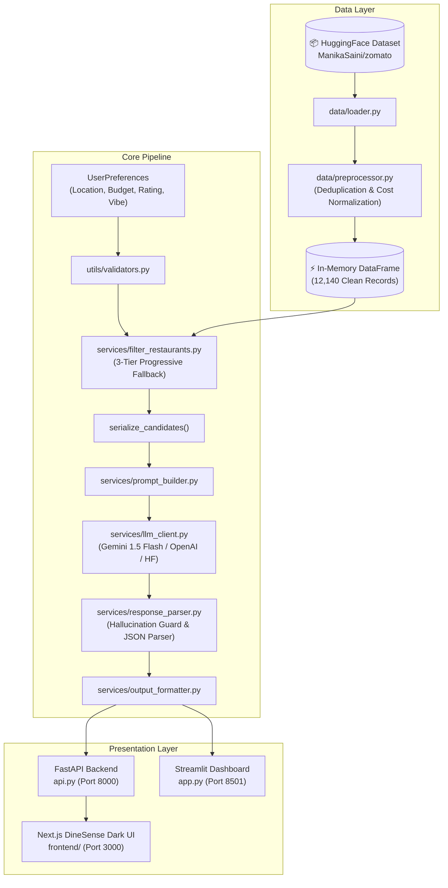

# 🍽️ Zomato AI DineSense — Sensory Intelligence & Restaurant Discovery

[](https://www.python.org/downloads/)
[](https://fastapi.tiangolo.com/)
[](https://nextjs.org/)
[](https://ai.google.dev/)
[-success.svg)](./tests)
[](./LICENSE)

An AI-powered restaurant recommendation engine and sensory intelligence platform that vectorizes natural language dining vibes (lighting, acoustic ambience, sourdough fermentation, specialty pour-overs), narrows candidates from **12,140 verified dining spots** with a 3-tier fallback algorithm, and delivers ranked recommendations backed by **Google Gemini** multimodal reasoning.

---

## 🏛️ System Architecture



---

## ✨ Key Features

1. **Midnight Glassmorphism Dark Theme**:
   - High-fidelity UI inspired by Google Stitch (`#0f131c` canvas, neon violet/cyan reasoning accents, and crimson primary conversion points).
2. **Natural Language Sensory Intent**:
   - Understands non-trivial dining nuances like *"Cozy leafy outdoor courtyard with single-origin pour-overs and blistered wood-fired sourdough"*.
3. **3-Tier Progressive Fallback Filter**:
   - Ensures no zero-match dead ends by progressively relaxing cuisine constraints and budget tiers while preserving locality proximity.
4. **Hallucination Prevention**:
   - Cross-checks all LLM recommendations against strictly filtered candidate names to ensure 100% real, verifiable restaurants.
5. **Multi-Provider LLM Resilience**:
   - Primary support for **Google Gemini 1.5 Flash** with retry, exponential backoff, stricter JSON reprompting, and automatic heuristic candidate ranking on API failures.
6. **Dual Presentation**:
   - **Modern Next.js 14 App Router** frontend for end-users.
   - **Streamlit Console** for admin dataset inspection and candidate debugging.

---

## 🚀 Quick Start

### 1. Prerequisites
- **Python**: `>= 3.10`
- **Node.js**: `>= 18.0` (for Next.js frontend)

### 2. Clone and Setup Environment

```bash
# Clone the repository
git clone https://github.com/your-username/zomato-recommendation.git
cd zomato-recommendation

# Create and activate virtual environment (Windows PowerShell)
python -m venv .venv
.venv\Scripts\activate

# Install Python dependencies
pip install -r requirements.txt
```

### 3. Configure Secrets

Copy `.env.example` to `.env` and supply your Google Gemini API key:

```ini
LLM_PROVIDER=gemini
GOOGLE_API_KEY=your_gemini_api_key_here
GEMINI_MODEL=gemini-1.5-flash
TOP_N_CANDIDATES=20
TOP_N_RECOMMENDATIONS=5
```

---

## 🏃‍♂️ Running the Services

### Start the FastAPI REST Backend (Terminal 1)
```powershell
.venv\Scripts\uvicorn api:app --reload --port 8000
```
- Interactive Swagger API Documentation: [http://localhost:8000/docs](http://localhost:8000/docs)
- Health Check: [http://localhost:8000/api/health](http://localhost:8000/api/health)

### Start the Next.js Frontend (Terminal 2)
```powershell
cd frontend
npm install
npm run dev
```
- Open [http://localhost:3000](http://localhost:3000) in your browser.

### (Optional) Start the Streamlit Explorer (Terminal 3)
```powershell
.venv\Scripts\streamlit run app.py
```
- Opens the Admin & Verification Console at [http://localhost:8501](http://localhost:8501).

---

## 🧪 Testing & Code Coverage

Run the comprehensive pytest suite:

```powershell
.venv\Scripts\pytest --cov=services --cov=data --cov=utils --cov=models tests/
```

### Coverage Summary (86% Overall):
| Module | Statements | Miss | Coverage |
|---|---|---|---|
| `services/output_formatter.py` | 6 | 0 | **100%** |
| `services/prompt_builder.py` | 8 | 0 | **100%** |
| `utils/validators.py` | 14 | 0 | **100%** |
| `models/restaurant.py` | 24 | 0 | **100%** |
| `services/filter_restaurants.py` | 43 | 2 | **95%** |
| `utils/logger.py` | 14 | 1 | **93%** |
| `data/loader.py` | 18 | 2 | **89%** |
| `data/preprocessor.py` | 61 | 9 | **85%** |
| `services/response_parser.py` | 60 | 12 | **80%** |
| `services/recommender.py` | 31 | 7 | **77%** |
| **Total** | **326** | **47** | **86%** |

---

## 📁 Repository Structure

```
Zomato/
├── api.py                    # FastAPI REST service serving the Next.js UI
├── app.py                    # Streamlit admin & verification explorer
├── requirements.txt          # Python runtime dependencies
├── .env.example              # Environment variables template
├── frontend/                 # Next.js 14 App Router TypeScript UI
│   ├── src/
│   │   ├── app/              # layout.tsx, page.tsx, globals.css
│   │   ├── components/       # Header, PreferenceSidebar, RecommendationFeed, Card, Skeleton
│   │   └── types/            # TypeScript interfaces
│   ├── tailwind.config.ts    # Midnight Glassmorphism design tokens
│   └── package.json
├── data/
│   ├── loader.py             # HuggingFace dataset loader
│   └── preprocessor.py       # Deduplication, rating & cost cleaning
├── services/
│   ├── filter_restaurants.py # 3-tier fallback candidate filter
│   ├── prompt_builder.py     # System & user prompt templates
│   ├── llm_client.py         # Multi-provider client with backoff
│   ├── response_parser.py    # JSON extractor & hallucination checker
│   ├── recommender.py        # End-to-end orchestration
│   └── output_formatter.py   # Match score & medal badges formatter
├── models/
│   └── restaurant.py         # Domain dataclasses (Restaurant, UserPreferences, Recommendation)
├── utils/
│   ├── validators.py         # Preference input validation
│   └── logger.py             # Structured logging utility
├── tests/                    # 79 unit & integration tests
└── doc/
    ├── ProblemStatement.md   # Product & engineering requirements
    ├── architecture.md       # High-level architecture specification
    └── ImplementationPlan.md # 6-Phase implementation roadmap
```

---

## 🌐 Production Deployment

Complete step-by-step instructions for deploying to production are documented in [deployment-plan.md](file:///c:/Nextleap/Zomato/deployment-plan.md):
- **Backend (FastAPI)**: Deployed on **Railway** with dynamic `$PORT` and `Procfile` / `Dockerfile`.
- **Frontend (Next.js 14)**: Deployed on **Vercel** with edge caching and environment variable `NEXT_PUBLIC_API_URL`.

---

## 📋 Acceptance Criteria Checklist

- [x] **Criterion 1**: Zomato dataset loaded & preprocessed from HuggingFace (`12,140` clean records).
- [x] **Criterion 2**: User preferences collected & strictly validated (location, budget, rating, vibe).
- [x] **Criterion 3**: Multi-factor candidate filtering with 3-tier progressive fallback logic.
- [x] **Criterion 4**: Structured prompt engine generating ranked outputs with natural language reasoning.
- [x] **Criterion 5**: Rich UI presenting restaurant name, cuisines, star rating, cost for two, and sensory reasoning.
- [x] **Criterion 6**: Edge cases handled (zero-matches, missing API keys, LLM hallucination rejection, JSON parse errors).

---

## 📄 License
This project is licensed under the MIT License — see the [LICENSE](LICENSE) file for details.

