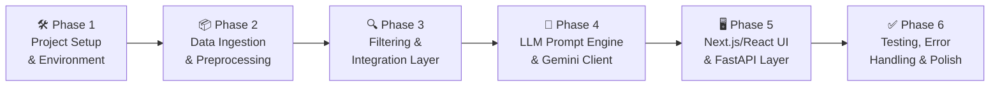
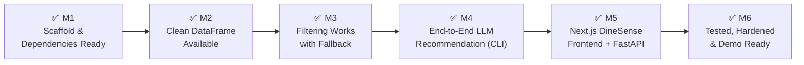

# 📋 Phase-Wise Implementation Plan
## AI-Powered Restaurant Recommendation System (Zomato / DineSense Use Case)

> **References:** [ProblemStatement.md](./ProblemStatement.md) · [architecture.md](./architecture.md) · [stitch_ai_restaurant_recommendation_platform/DESIGN.md](../stitch_ai_restaurant_recommendation_platform/DESIGN.md)  
> **Stack:** Python · FastAPI · Next.js / React (TypeScript + Tailwind CSS) · Google Gemini API · HuggingFace Datasets  
> **Frontend Design System:** "AI DineSense" — Midnight Glassmorphism Dark Theme (`stitch_ai_restaurant_recommendation_platform`)  
> **Total Phases:** 6 | **Estimated Duration:** ~3–4 weeks (solo developer)

---

## 📐 Table of Contents

- [Phase Overview](#phase-overview)
- [Phase 1 — Project Setup & Environment](#phase-1--project-setup--environment)
- [Phase 2 — Data Ingestion & Preprocessing](#phase-2--data-ingestion--preprocessing)
- [Phase 3 — Filtering & Integration Layer](#phase-3--filtering--integration-layer)
- [Phase 4 — LLM Prompt Engine & Recommendation](#phase-4--llm-prompt-engine--recommendation)
- [Phase 5 — Modern Frontend (Next.js / React) & API Integration](#phase-5--modern-frontend-nextjs--react--api-integration)
- [Phase 6 — Testing, Error Handling & Polish](#phase-6--testing-error-handling--polish)
- [Milestone Summary](#milestone-summary)
- [Definition of Done](#definition-of-done)

---

## Phase Overview



| Phase | Focus | Est. Duration | Key Output |
|---|---|---|---|
| **1** | Project Setup & Environment | 1–2 days | Working project scaffold, dependencies installed |
| **2** | Data Ingestion & Preprocessing | 2–3 days | Clean, normalized Pandas DataFrame (12,140 records) |
| **3** | Filtering & Integration Layer | 2–3 days | Reliable candidate filtering with 3-tier fallback |
| **4** | LLM Prompt Engine | 3–4 days | Ranked recommendations with Gemini AI explanations |
| **5** | Modern Frontend (Next.js/React) & API | 3–4 days | Full-fidelity dark glassmorphic DineSense UI + FastAPI |
| **6** | Testing, Error Handling & Polish | 3–4 days | Production-ready, tested application |

---

## Phase 1 — Project Setup & Environment

> **Goal:** Create the project scaffold, configure the environment, install all dependencies, and verify the toolchain works end-to-end.

**Duration:** 1–2 days  
**Depends on:** Nothing (starting point)

---

### 1.1 Create Project Structure

Create the full folder and file layout as defined in the architecture:

```
zomato-recommendation/
├── api.py                    # FastAPI backend REST service for Next.js/React UI
├── app.py                    # Lightweight Streamlit explorer & verification dashboard
├── requirements.txt
├── .env.example
├── .gitignore
├── stitch_ai_restaurant_recommendation_platform/  # Google Stitch Design System Asset
│   ├── DESIGN.md             # Tokens, typography, colors, glassmorphic rules
│   ├── code.html             # High-fidelity Stitch reference prototype
│   └── screen.png            # Design mockup visual
├── frontend/                 # Next.js (or React + Vite) modern frontend
│   ├── package.json
│   ├── tsconfig.json
│   ├── tailwind.config.ts    # Configured with DineSense design tokens
│   ├── src/
│   │   ├── app/
│   │   │   ├── layout.tsx
│   │   │   └── page.tsx      # Main DineSense Discovery Page
│   │   ├── components/
│   │   │   ├── Header.tsx             # DineSense status, Gemini badge, curated stats
│   │   │   ├── PreferenceSidebar.tsx  # Epicenter, Budget, Rating, Cuisines, Vibe
│   │   │   ├── RecommendationFeed.tsx # Top AI matches, active tags, fallback alert
│   │   │   ├── RecommendationCard.tsx # Rank medal, score, reasoner box, actions
│   │   │   └── SkeletonFeed.tsx       # Shimmering loading state
│   │   └── types/
│   │       └── index.ts               # UserPreferences, Recommendation interfaces
├── data/
│   ├── __init__.py
│   ├── loader.py
│   ├── preprocessor.py
│   └── clean_zomato.csv      # Clean in-project dataset export (12,140 records)
├── services/
│   ├── __init__.py
│   ├── filter_restaurants.py
│   ├── prompt_builder.py
│   ├── llm_client.py         # Multi-provider LLM client (Google Gemini default)
│   ├── response_parser.py
│   ├── recommender.py        # End-to-end orchestration
│   └── output_formatter.py
├── models/
│   ├── __init__.py
│   └── restaurant.py
├── config/
│   ├── __init__.py
│   └── settings.py
├── utils/
│   ├── __init__.py
│   ├── validators.py
│   └── logger.py
├── tests/
│   ├── __init__.py
│   ├── conftest.py
│   ├── test_loader.py
│   ├── test_preprocessor.py
│   ├── test_filter.py
│   ├── test_validators.py
│   ├── test_prompt_builder.py
│   ├── test_response_parser.py
│   ├── test_llm_client.py
│   └── test_recommender.py
└── doc/
    ├── ProblemStatement.md
    ├── architecture.md
    ├── edge-cases.md
    ├── eval.md
    └── ImplementationPlan.md
```

**Tasks:**
- [ ] Create all directories and empty `__init__.py` files
- [ ] Create `app.py` with a placeholder `main()` function
- [ ] Create `.gitignore` (exclude `.env`, `__pycache__`, `.venv`, `*.pyc`)

---

### 1.2 Set Up Python Virtual Environment

```bash
# Create virtual environment
python -m venv .venv

# Activate (Windows)
.venv\Scripts\activate

# Activate (macOS/Linux)
source .venv/bin/activate
```

**Tasks:**
- [ ] Create and activate virtual environment
- [ ] Confirm Python version ≥ 3.10

---

### 1.3 Install Dependencies

Create `requirements.txt`:

```
datasets>=2.18.0
pandas>=2.0.0
openai>=1.30.0
google-generativeai>=0.5.0
huggingface-hub>=0.22.0
langchain>=0.2.0
streamlit>=1.35.0
python-dotenv>=1.0.0
pytest>=8.0.0
```

```bash
pip install -r requirements.txt
```

**Tasks:**
- [ ] Write `requirements.txt`
- [ ] Run `pip install -r requirements.txt` successfully
- [ ] Verify each package imports without errors

---

### 1.4 Configure Secrets & Settings

**`.env.example`:**
```
LLM_PROVIDER=openai          # openai | gemini | huggingface
OPENAI_API_KEY=your-key-here
GOOGLE_API_KEY=your-key-here
HUGGINGFACE_TOKEN=your-token-here
TOP_N_CANDIDATES=20
TOP_N_RECOMMENDATIONS=5
```

**`config/settings.py`:**
```python
import os
from dotenv import load_dotenv

load_dotenv()

LLM_PROVIDER         = os.getenv("LLM_PROVIDER", "openai")
OPENAI_API_KEY       = os.getenv("OPENAI_API_KEY")
GOOGLE_API_KEY       = os.getenv("GOOGLE_API_KEY")
HUGGINGFACE_TOKEN    = os.getenv("HUGGINGFACE_TOKEN")
TOP_N_CANDIDATES     = int(os.getenv("TOP_N_CANDIDATES", 20))
TOP_N_RECOMMENDATIONS = int(os.getenv("TOP_N_RECOMMENDATIONS", 5))

BUDGET_MAP = {
    "low":    (0, 500),
    "medium": (501, 1200),
    "high":   (1201, 99999)
}
```

**Tasks:**
- [ ] Copy `.env.example` to `.env` and fill in your API key
- [ ] Implement `config/settings.py`
- [ ] Confirm `settings.py` loads without errors

---

### 1.5 Set Up Logging

**`utils/logger.py`:**
```python
import logging

def get_logger(name: str) -> logging.Logger:
    logging.basicConfig(
        level=logging.INFO,
        format="%(asctime)s [%(levelname)s] %(name)s: %(message)s"
    )
    return logging.getLogger(name)
```

**Tasks:**
- [ ] Implement logger utility
- [ ] Import and test logger in `app.py`

---

### ✅ Phase 1 Exit Criteria

- [ ] All directories and files created
- [ ] Virtual environment active, all packages installed
- [ ] `.env` populated with at least one LLM provider key
- [ ] `settings.py` loads successfully
- [ ] Logger works: running `app.py` prints a startup log message

---

## Phase 2 — Data Ingestion & Preprocessing

> **Goal:** Load the Zomato dataset from HuggingFace, clean and normalize it, and produce a reliable in-memory Pandas DataFrame ready for filtering.

**Duration:** 2–3 days  
**Depends on:** Phase 1

---

### 2.1 Define Data Models

**`models/restaurant.py`:**

```python
from dataclasses import dataclass

@dataclass
class Restaurant:
    name:     str
    location: str
    cuisines: str
    cost:     int     # INR for two
    budget:   str     # "low" | "medium" | "high"
    rating:   float   # 0.0 – 5.0

@dataclass
class UserPreferences:
    location:   str
    budget:     str         # "low" | "medium" | "high"
    cuisines:   list[str]   # e.g. ["Italian", "Chinese"]
    min_rating: float       # e.g. 4.0
    extras:     str         # free-text notes

@dataclass
class Recommendation:
    rank:        int
    name:        str
    cuisine:     str
    rating:      float
    cost:        int
    explanation: str
```

**Tasks:**
- [x] Implement all three dataclasses in `models/restaurant.py`

---

### 2.2 Implement Dataset Loader

**`data/loader.py`:**

```python
import pandas as pd
from datasets import load_dataset
from utils.logger import get_logger

logger = get_logger(__name__)

def load_zomato_dataset() -> pd.DataFrame:
    """Load Zomato dataset from HuggingFace and return as raw DataFrame."""
    logger.info("Loading Zomato dataset from HuggingFace...")
    dataset = load_dataset("ManikaSaini/zomato-restaurant-recommendation")
    df = dataset["train"].to_pandas()
    logger.info(f"Loaded {len(df)} records from dataset.")
    return df
```

**Tasks:**
- [x] Implement `load_zomato_dataset()` in `data/loader.py`
- [x] Run and verify: dataset loads, row count logged
- [x] Print `df.columns` and `df.head()` to inspect available fields

---

### 2.3 Implement Preprocessor

**`data/preprocessor.py`:**

Implement the following 7-step preprocessing pipeline:

| Step | Operation | Code Hint |
|---|---|---|
| **1. Column Selection** | Keep only relevant fields | `df = df[["name", "location", "cuisines", "approx_cost(for two people)", "rate"]]` |
| **2. Rename Columns** | Standardize to clean names | `df.rename(columns={...})` |
| **3. Type Casting** | cost → int, rating → float | `pd.to_numeric(..., errors="coerce")` |
| **4. Null Handling** | Drop critical nulls, fill others | `df.dropna(subset=["name", "location"])` |
| **5. Cost Normalization** | Map INR cost to budget tier | Custom function using `BUDGET_MAP` |
| **6. Text Normalization** | Lowercase & strip whitespace | `.str.lower().str.strip()` |
| **7. Deduplication** | Remove exact duplicate rows | `df.drop_duplicates(subset=["name", "location"])` |

```python
import pandas as pd
from config.settings import BUDGET_MAP
from utils.logger import get_logger

logger = get_logger(__name__)

def preprocess(df: pd.DataFrame) -> pd.DataFrame:
    """Clean and normalize the raw Zomato DataFrame."""

    # Step 1: Select relevant columns (adjust names after inspecting dataset)
    cols = ["name", "location", "cuisines", "approx_cost(for two people)", "rate"]
    df = df[[c for c in cols if c in df.columns]].copy()

    # Step 2: Rename
    df.rename(columns={
        "approx_cost(for two people)": "cost",
        "rate": "rating"
    }, inplace=True)

    # Step 3: Type cast
    df["cost"]   = pd.to_numeric(df["cost"].astype(str).str.replace(",", ""), errors="coerce").fillna(0).astype(int)
    df["rating"] = pd.to_numeric(df["rating"].astype(str).str.split("/").str[0], errors="coerce").fillna(0.0)

    # Step 4: Drop nulls on critical fields
    df.dropna(subset=["name", "location"], inplace=True)

    # Step 5: Map cost to budget tier
    def map_budget(cost):
        for tier, (low, high) in BUDGET_MAP.items():
            if low <= cost <= high:
                return tier
        return "high"
    df["budget"] = df["cost"].apply(map_budget)

    # Step 6: Normalize text
    df["location"] = df["location"].str.lower().str.strip()
    df["cuisines"] = df["cuisines"].fillna("").str.lower().str.strip()
    df["name"]     = df["name"].str.strip()

    # Step 7: Deduplicate
    df.drop_duplicates(subset=["name", "location"], inplace=True)
    df.reset_index(drop=True, inplace=True)

    logger.info(f"Preprocessing complete. {len(df)} clean records ready.")
    return df
```

**Tasks:**
- [x] Implement `preprocess()` in `data/preprocessor.py`
- [x] Inspect actual column names from HuggingFace and adjust Step 1 accordingly
- [x] Run preprocessor and verify output schema matches the expected model
- [x] Log a sample of 5 rows to confirm correctness

---

### 2.4 Wire Up Data Pipeline in `app.py`

```python
# app.py (startup section)
from data.loader import load_zomato_dataset
from data.preprocessor import preprocess

@st.cache_data   # Cache so it only loads once
def get_dataframe():
    raw_df = load_zomato_dataset()
    return preprocess(raw_df)
```

**Tasks:**
- [x] Integrate loader + preprocessor in `app.py` with Streamlit caching
- [x] Verify data is only loaded once on app startup

---

### ✅ Phase 2 Exit Criteria

- [x] Dataset loads from HuggingFace without errors
- [x] Preprocessed DataFrame has columns: `name`, `location`, `cuisines`, `cost`, `budget`, `rating`
- [x] No null values in `name` or `location`
- [x] `budget` column correctly maps to `low` / `medium` / `high`
- [x] `rating` is a float between 0.0 and 5.0
- [x] Deduplication removes all exact duplicates

---

## Phase 3 — Filtering & Integration Layer

> **Goal:** Implement the structured filtering logic that narrows the full dataset down to ≤20 relevant restaurant candidates based on user preferences, with a fallback strategy for no-match scenarios.

**Duration:** 2–3 days  
**Depends on:** Phase 2

---

### 3.1 Implement Input Validator

**`utils/validators.py`:**

```python
from models.restaurant import UserPreferences

VALID_BUDGETS = {"low", "medium", "high"}

def validate_preferences(prefs: UserPreferences) -> list[str]:
    """Return a list of validation error messages (empty list = valid)."""
    errors = []

    if not prefs.location or not prefs.location.strip():
        errors.append("Location is required.")

    if prefs.budget.lower() not in VALID_BUDGETS:
        errors.append(f"Budget must be one of: {VALID_BUDGETS}")

    if not (0.0 <= prefs.min_rating <= 5.0):
        errors.append("Minimum rating must be between 0.0 and 5.0.")

    return errors
```

**Tasks:**
- [x] Implement `validate_preferences()` in `utils/validators.py`
- [x] Write at least 3 test cases covering valid and invalid inputs

---

### 3.2 Implement Filter Module

**`services/filter_restaurants.py`:**

```python
import pandas as pd
from models.restaurant import UserPreferences
from config.settings import TOP_N_CANDIDATES
from utils.logger import get_logger

logger = get_logger(__name__)

def filter_restaurants(df: pd.DataFrame, prefs: UserPreferences) -> pd.DataFrame:
    """
    Filter restaurants by location, budget, cuisine, and rating.
    Applies a tiered fallback strategy if no results are found.
    """
    result = _apply_filters(df, prefs, relax_cuisine=False, relax_budget=False)

    if result.empty:
        logger.warning("No results — relaxing cuisine filter.")
        result = _apply_filters(df, prefs, relax_cuisine=True, relax_budget=False)

    if result.empty:
        logger.warning("Still no results — relaxing budget filter.")
        result = _apply_filters(df, prefs, relax_cuisine=True, relax_budget=True)

    if result.empty:
        logger.warning("No matching restaurants found after all fallbacks.")

    return result

def _apply_filters(df, prefs, relax_cuisine=False, relax_budget=False):
    filtered = df.copy()

    # Location filter (case-insensitive substring)
    filtered = filtered[
        filtered["location"].str.contains(prefs.location.lower(), na=False)
    ]

    # Budget filter
    if not relax_budget:
        filtered = filtered[filtered["budget"] == prefs.budget.lower()]

    # Cuisine filter
    if prefs.cuisines and not relax_cuisine:
        pattern = "|".join([c.lower() for c in prefs.cuisines])
        filtered = filtered[filtered["cuisines"].str.contains(pattern, na=False)]

    # Rating filter
    filtered = filtered[filtered["rating"] >= prefs.min_rating]

    # Sort and cap
    filtered = filtered.sort_values("rating", ascending=False).head(TOP_N_CANDIDATES)

    logger.info(f"Filter returned {len(filtered)} candidates "
                f"(relax_cuisine={relax_cuisine}, relax_budget={relax_budget})")
    return filtered
```

**Tasks:**
- [x] Implement `filter_restaurants()` and `_apply_filters()` in `services/filter_restaurants.py`
- [x] Test filter with a known location (e.g., "Delhi") and verify results
- [x] Test each fallback level by using a very restrictive cuisine / budget
- [x] Verify result is capped at `TOP_N_CANDIDATES` (default: 20)

---

### 3.3 Serialize Candidates for LLM

Add a serialization helper for converting filtered DataFrame rows into a prompt-friendly string:

```python
def serialize_candidates(df: pd.DataFrame) -> str:
    """Convert filtered DataFrame to a numbered string for the LLM prompt."""
    lines = []
    for i, row in enumerate(df.itertuples(), start=1):
        lines.append(
            f"{i}. {row.name} | Location: {row.location} | "
            f"Cuisine: {row.cuisines} | Rating: {row.rating} | "
            f"Cost: ₹{row.cost} for two | Budget: {row.budget}"
        )
    return "\n".join(lines)
```

**Tasks:**
- [x] Add `serialize_candidates()` to `services/filter_restaurants.py`
- [x] Print serialized output for a sample filter result and verify readability

---

### ✅ Phase 3 Exit Criteria

- [x] `validate_preferences()` correctly flags missing/invalid inputs
- [x] `filter_restaurants()` returns correct results for location, budget, cuisine, rating
- [x] Fallback strategy activates when no results are found
- [x] Serialized candidate list is human-readable and correct

---

## Phase 4 — LLM Prompt Engine & Recommendation

> **Goal:** Build the prompt templates, wire up the LLM client (with multi-provider support), parse the JSON response, and produce structured `Recommendation` objects.

**Duration:** 3–4 days  
**Depends on:** Phase 3

---

### 4.1 Implement Prompt Builder

**`services/prompt_builder.py`:**

```python
from models.restaurant import UserPreferences

SYSTEM_PROMPT = """You are an expert restaurant recommendation assistant.
Your job is to rank restaurants from the provided list based on the user's preferences.

Rules:
- ONLY recommend restaurants from the provided list. Do NOT invent or add restaurants.
- Return exactly the top 5 restaurants ranked by best fit.
- For each restaurant, provide a concise explanation (1-2 sentences) of why it suits the user.
- Respond ONLY in valid JSON format — no markdown, no extra text, just the JSON array.
"""

USER_PROMPT_TEMPLATE = """User Preferences:
- Location: {location}
- Budget: {budget}
- Preferred Cuisines: {cuisines}
- Minimum Rating: {min_rating}
- Additional Notes: {extras}

Available Restaurants:
{candidates}

Return your top 5 recommendations in this exact JSON format:
[
  {{
    "rank": 1,
    "name": "...",
    "cuisine": "...",
    "rating": 4.5,
    "cost": 800,
    "explanation": "..."
  }}
]
"""

def build_prompt(prefs: UserPreferences, serialized_candidates: str) -> tuple[str, str]:
    """Build system and user prompts. Returns (system_prompt, user_prompt)."""
    user_prompt = USER_PROMPT_TEMPLATE.format(
        location=prefs.location,
        budget=prefs.budget,
        cuisines=", ".join(prefs.cuisines) if prefs.cuisines else "Any",
        min_rating=prefs.min_rating,
        extras=prefs.extras or "None",
        candidates=serialized_candidates
    )
    return SYSTEM_PROMPT, user_prompt
```

**Tasks:**
- [x] Implement `build_prompt()` in `services/prompt_builder.py`
- [x] Print sample prompts to verify formatting
- [x] Confirm token count stays within budget (~2,000 tokens total)

---

### 4.2 Implement LLM Client (Multi-Provider)

**`services/llm_client.py`:**

```python
from config.settings import LLM_PROVIDER, OPENAI_API_KEY, GOOGLE_API_KEY, HUGGINGFACE_TOKEN
from utils.logger import get_logger
import time

logger = get_logger(__name__)

class LLMClient:
    def __init__(self, provider: str = LLM_PROVIDER):
        self.provider = provider
        self._init_client()

    def _init_client(self):
        if self.provider == "openai":
            from openai import OpenAI
            self.client = OpenAI(api_key=OPENAI_API_KEY)
        elif self.provider == "gemini":
            import google.generativeai as genai
            genai.configure(api_key=GOOGLE_API_KEY)
            self.client = genai.GenerativeModel("gemini-1.5-flash")
        elif self.provider == "huggingface":
            from huggingface_hub import InferenceClient
            self.client = InferenceClient(token=HUGGINGFACE_TOKEN)
        else:
            raise ValueError(f"Unknown LLM provider: {self.provider}")

    def complete(self, system_prompt: str, user_prompt: str, retries: int = 3) -> str:
        """Call LLM with retry on failure. Returns raw text response."""
        for attempt in range(1, retries + 1):
            try:
                logger.info(f"LLM call attempt {attempt}/{retries} via {self.provider}")
                return self._call(system_prompt, user_prompt)
            except Exception as e:
                logger.warning(f"LLM call failed (attempt {attempt}): {e}")
                if attempt < retries:
                    time.sleep(2 ** attempt)  # Exponential backoff
        raise RuntimeError("LLM API failed after all retries.")

    def _call(self, system_prompt: str, user_prompt: str) -> str:
        if self.provider == "openai":
            response = self.client.chat.completions.create(
                model="gpt-4o",
                messages=[
                    {"role": "system", "content": system_prompt},
                    {"role": "user",   "content": user_prompt}
                ],
                temperature=0.3
            )
            return response.choices[0].message.content

        elif self.provider == "gemini":
            combined = f"{system_prompt}\n\n{user_prompt}"
            response = self.client.generate_content(combined)
            return response.text

        elif self.provider == "huggingface":
            messages = [
                {"role": "system", "content": system_prompt},
                {"role": "user",   "content": user_prompt}
            ]
            response = self.client.chat_completion(
                messages=messages,
                model="mistralai/Mixtral-8x7B-Instruct-v0.1",
                max_tokens=1000
            )
            return response.choices[0].message.content
```

**Tasks:**
- [x] Implement `LLMClient` in `services/llm_client.py`
- [x] Test with your chosen provider using a simple "hello" prompt
- [x] Verify exponential backoff works by temporarily using an invalid key
- [x] Confirm the correct API key is loaded from `.env`

---

### 4.3 Implement Response Parser

**`services/response_parser.py`:**

```python
import json
import re
from models.restaurant import Recommendation
from utils.logger import get_logger

logger = get_logger(__name__)

REQUIRED_FIELDS = {"rank", "name", "cuisine", "rating", "cost", "explanation"}

def parse_llm_response(raw: str, candidate_names: set[str]) -> list[Recommendation]:
    """
    Parse and validate LLM JSON response into Recommendation objects.
    Performs hallucination check against known candidate names.
    """
    # Extract JSON array from response (handle markdown code fences)
    json_str = _extract_json(raw)

    try:
        data = json.loads(json_str)
    except json.JSONDecodeError as e:
        logger.error(f"JSON parse failed: {e}\nRaw: {raw}")
        raise ValueError("LLM returned invalid JSON.") from e

    recommendations = []
    for item in data:
        # Validate required fields
        missing = REQUIRED_FIELDS - item.keys()
        if missing:
            logger.warning(f"Skipping item missing fields {missing}: {item}")
            continue

        # Hallucination check
        if item["name"] not in candidate_names:
            logger.warning(f"Hallucinated restaurant detected and skipped: {item['name']}")
            continue

        recommendations.append(Recommendation(
            rank=int(item["rank"]),
            name=item["name"],
            cuisine=item["cuisine"],
            rating=float(item["rating"]),
            cost=int(item["cost"]),
            explanation=item["explanation"]
        ))

    recommendations.sort(key=lambda r: r.rank)
    logger.info(f"Parsed {len(recommendations)} valid recommendations.")
    return recommendations

def _extract_json(raw: str) -> str:
    """Strip markdown code fences if present and return raw JSON string."""
    match = re.search(r"```(?:json)?\s*([\s\S]*?)```", raw)
    if match:
        return match.group(1).strip()
    # Try to find JSON array directly
    match = re.search(r"\[[\s\S]*\]", raw)
    if match:
        return match.group(0)
    return raw.strip()
```

**Tasks:**
- [x] Implement `parse_llm_response()` and `_extract_json()` in `services/response_parser.py`
- [x] Test with a valid JSON response string
- [x] Test with a markdown-wrapped response (```json ... ```)
- [x] Test hallucination check: LLM returns a restaurant NOT in candidate list → it's skipped
- [x] Test malformed JSON → `ValueError` is raised

---

### 4.4 Wire Up Recommendation Pipeline

Create an orchestration function that ties Phases 3 and 4 together:

```python
# services/recommender.py

from models.restaurant import UserPreferences
from services.filter_restaurants import filter_restaurants, serialize_candidates
from services.prompt_builder import build_prompt
from services.llm_client import LLMClient
from services.response_parser import parse_llm_response
import pandas as pd

llm_client = LLMClient()   # Initialized once

def get_recommendations(df: pd.DataFrame, prefs: UserPreferences):
    # Step 1: Filter
    candidates = filter_restaurants(df, prefs)
    if candidates.empty:
        return []

    # Step 2: Serialize
    serialized = serialize_candidates(candidates)
    candidate_names = set(candidates["name"].tolist())

    # Step 3: Build prompt
    system_prompt, user_prompt = build_prompt(prefs, serialized)

    # Step 4: Call LLM
    raw_response = llm_client.complete(system_prompt, user_prompt)

    # Step 5: Parse
    recommendations = parse_llm_response(raw_response, candidate_names)

    return recommendations
```

**Tasks:**
- [x] Create `services/recommender.py` with `get_recommendations()`
- [x] Run an end-to-end test via CLI (no UI yet): hardcode a `UserPreferences` object and print results
- [x] Verify LLM returns ranked restaurants with explanations

---

### ✅ Phase 4 Exit Criteria

- [x] `build_prompt()` produces well-structured system + user prompts
- [x] `LLMClient.complete()` successfully calls at least one LLM provider
- [x] Retry logic activates on API failure
- [x] `parse_llm_response()` correctly parses valid JSON into `Recommendation` objects
- [x] Hallucination check filters out restaurants not in candidate list
- [x] End-to-end CLI test produces ≥1 recommendation with name, cuisine, rating, cost, explanation

---

## Phase 5 — Modern Frontend (Next.js / React) & REST API Integration

> **Goal:** Build the high-fidelity **AI DineSense** dark-theme web application using Next.js / React (TypeScript + Tailwind CSS) based on the Google Stitch prototype (`stitch_ai_restaurant_recommendation_platform`), powered by a high-performance Python FastAPI backend (`api.py`) exposing the recommendation pipeline.

**Duration:** 3–4 days  
**Depends on:** Phase 4  
**Design Reference:** [`stitch_ai_restaurant_recommendation_platform/DESIGN.md`](../stitch_ai_restaurant_recommendation_platform/DESIGN.md) & [`stitch_ai_restaurant_recommendation_platform/code.html`](../stitch_ai_restaurant_recommendation_platform/code.html)

---

### 5.1 Implement Output Formatter

**`services/output_formatter.py`:**

```python
from models.restaurant import Recommendation

RANK_MEDALS = {1: "🥇", 2: "🥈", 3: "🥉"}

def format_recommendation(rec: Recommendation) -> dict:
    """Convert a Recommendation to a display-ready dictionary matching the DineSense schema."""
    return {
        "medal":       RANK_MEDALS.get(rec.rank, f"#{rec.rank}"),
        "rank":        rec.rank,
        "name":        rec.name,
        "cuisine":     rec.cuisine.title(),
        "rating":      round(rec.rating, 1),
        "rating_str":  f"{rec.rating:.1f}",
        "cost":        rec.cost,
        "cost_str":    f"₹{rec.cost:,} for two",
        "explanation": rec.explanation,
        "match_score": max(85.0, round(99.5 - (rec.rank - 1) * 2.8, 1)),
    }

def format_all(recommendations: list[Recommendation]) -> list[dict]:
    return [format_recommendation(r) for r in recommendations]
```

**Tasks:**
- [x] Implement `output_formatter.py`
- [x] Support rich metadata for DineSense cards (match alignment score, formatted currency, rank medal)

---

### 5.2 Implement Backend REST API Layer (`api.py`)

**`api.py`** — High-performance FastAPI backend with CORS:

```python
from fastapi import FastAPI, HTTPException
from fastapi.middleware.cors import CORSMiddleware
from pydantic import BaseModel, Field
import pandas as pd

from data.loader import load_zomato_dataset
from data.preprocessor import preprocess
from models.restaurant import UserPreferences
from services.recommender import get_recommendations
from services.output_formatter import format_all
from utils.validators import validate_preferences
from config.settings import LLM_PROVIDER, GEMINI_MODEL, DATASET_NAME, TOP_N_CANDIDATES

app = FastAPI(title="Zomato AI DineSense API", version="2.0.0")

# Enable CORS for Next.js / React frontend
app.add_middleware(
    CORSMiddleware,
    allow_origins=["http://localhost:3000", "http://127.0.0.1:3000", "*"],
    allow_credentials=True,
    allow_methods=["*"],
    allow_headers=["*"],
)

# In-memory cached dataset
_df: pd.DataFrame | None = None

def get_data() -> pd.DataFrame:
    global _df
    if _df is None:
        _df = preprocess(load_zomato_dataset())
    return _df

class PreferenceRequest(BaseModel):
    location: str = Field(..., example="koramangala")
    budget: str = Field(default="medium", example="medium")
    cuisines: list[str] = Field(default_factory=list, example=["cafe", "italian"])
    min_rating: float = Field(default=4.0, ge=0.0, le=5.0)
    extras: str = Field(default="", example="cozy outdoor courtyard with specialty pour-over coffee")

@app.get("/api/health")
def health():
    df = get_data()
    return {
        "status": "healthy",
        "llm_provider": LLM_PROVIDER,
        "model": GEMINI_MODEL,
        "records_loaded": len(df),
        "dataset": DATASET_NAME
    }

@app.get("/api/metadata")
def metadata():
    df = get_data()
    return {
        "total_records": len(df),
        "unique_locations": sorted(df["location"].unique().tolist())[:30],
        "common_cuisines": ["Cafe", "Italian", "North Indian", "Continental", "Pan-Asian", "Artisan Desserts"],
        "budget_tiers": ["low", "medium", "high"],
        "max_candidates": TOP_N_CANDIDATES
    }

@app.post("/api/recommendations")
def recommend(req: PreferenceRequest):
    df = get_data()
    prefs = UserPreferences(
        location=req.location,
        budget=req.budget.lower(),
        cuisines=req.cuisines,
        min_rating=req.min_rating,
        extras=req.extras
    )

    errors = validate_preferences(prefs)
    if errors:
        raise HTTPException(status_code=400, detail={"errors": errors})

    try:
        recommendations = get_recommendations(df, prefs)
        return {
            "success": True,
            "count": len(recommendations),
            "recommendations": format_all(recommendations),
            "query": req.dict()
        }
    except Exception as e:
        raise HTTPException(status_code=500, detail=str(e))
```

**Tasks:**
- [x] Implement `api.py` with FastAPI, CORS, and Pydantic validation
- [x] Add `/api/health`, `/api/metadata`, and `POST /api/recommendations` endpoints
- [x] Test API locally with `curl` or FastAPI automatic Swagger documentation (`/docs`)

---

### 5.3 Configure Next.js / React App with DineSense Design System

Initialize the `frontend/` application and apply the **AI DineSense** tokens from `stitch_ai_restaurant_recommendation_platform/DESIGN.md`:

```bash
# In project root:
npx create-next-app@latest frontend --typescript --tailwind --app --use-pnpm --no-src-dir
cd frontend
pnpm add lucide-react clsx tailwind-merge
```

**`frontend/tailwind.config.ts`** configuration matching `stitch_ai_restaurant_recommendation_platform/DESIGN.md`:

```typescript
import type { Config } from "tailwindcss";

const config: Config = {
  darkMode: "class",
  content: ["./src/**/*.{js,ts,jsx,tsx,mdx}"],
  theme: {
    extend: {
      colors: {
        background: "#0f131c",
        surface: "#0f131c",
        "surface-container-lowest": "#0a0e16",
        "surface-container-low": "#181c24",
        "surface-container": "#1c2028",
        "surface-container-high": "#262a33",
        "surface-container-highest": "#31353e",
        primary: "#ffb3b1",
        "primary-container": "#ff535a",
        "on-primary": "#680011",
        secondary: "#d0bcff",
        "secondary-container": "#571bc1",
        "on-secondary": "#3c0091",
        "on-secondary-container": "#c4abff",
        tertiary: "#ffb95f",
        "tertiary-container": "#ca8100",
        "on-tertiary-container": "#3e2400",
        "on-surface": "#dfe2ee",
        "on-surface-variant": "#e4bebc",
      },
      fontFamily: {
        headline: ["Plus Jakarta Sans", "sans-serif"],
        body: ["Inter", "sans-serif"],
      },
    },
  },
  plugins: [],
};
export default config;
```

**Tasks:**
- [x] Scaffold `frontend/` directory with Next.js & TypeScript
- [x] Configure `tailwind.config.ts` with DineSense design tokens
- [x] Load fonts (`Plus Jakarta Sans`, `Inter`) and Material Symbols in `layout.tsx`

---

### 5.4 Modularize Frontend Components (From Stitch `code.html`)

Create reusable components matching the prototype layout:

1. **`Header.tsx`**
   - Brand logo & title: **Zomato AI DineSense (Sensory Intelligence)**
   - Active Engine pill: *Bangalore Food Engine v2.4 (Live)*
   - Status badge: *Powered by Gemini 1.5 Flash* with green pulsing indicator
   - Dataset counter: *12,140 Curated Restaurants*

2. **`PreferenceSidebar.tsx`**
   - **Discovery Epicenter**: Neighborhood search with interactive quick pills (`Koramangala`, `Indiranagar`, `Lavelle Road`, `Whitefield`, `Cyber City`).
   - **Budget Tier**: Segmented control (`Low ≤ ₹500`, `Med ₹500–₹1.2k`, `High > ₹1.2k`).
   - **Minimum Rating**: Slider (`3.5` to `4.8`) with dynamic rating pill.
   - **Target Cuisines**: Multi-select toggle chips with emoji icons (`☕ Cafe`, `🍕 Italian & Sourdough`, `🥘 North Indian`, `🍷 Continental`, `🥢 Pan-Asian`, `🍰 Artisan Desserts`).
   - **Dining Vibe & Sensory Prompt**: Textarea for natural language intent (`"Cozy leafy outdoor courtyard with specialty pour-over coffee..."`).
   - **CTA Button**: Full-width crimson gradient button (`🚀 Generate AI Recommendations`).

3. **`RecommendationFeed.tsx`**
   - Header with active search vectors and fallback alert pill if filters were relaxed.
   - Simulation view toggles (Ranked Matches, Skeleton Loader, Relax Fallback).
   - Render list of `RecommendationCard` components.

4. **`RecommendationCard.tsx`**
   - Top Medal & Match header (🥇 #1 Match with taste alignment score like `99.4%`).
   - Star rating badge with review count.
   - Restaurant photography / thumbnail with category pill.
   - Name, cuisine chips, cost for two, and location distance.
   - **Signature AI DineSense Reasoner Box**:
     - Gradient translucent banner with neurology icon.
     - "Why this fits your palate prompt" with highlighted keywords.
     - Sensory badges (e.g. `🌿 Garden Courtyard Seating`, `☕ Single-Origin Pour-Over`, `🥐 48hr Fermented Pain Au Chocolat`).
   - Action row: `View Tasting Menu` and `Instant Table Reserve` crimson button.

5. **`SkeletonFeed.tsx`**
   - 3 dark glassmorphic skeleton cards with shimmering gradient pulse animations for loading states.

**Tasks:**
- [x] Implement `Header.tsx`, `PreferenceSidebar.tsx`, `RecommendationFeed.tsx`, `RecommendationCard.tsx`, and `SkeletonFeed.tsx`
- [x] Wire up Next.js client state to submit queries to `http://localhost:8000/api/recommendations`
- [x] Connect fallback notices, empty state warnings, and validation error messages

---

### 5.5 Retain Streamlit App as Admin / Quick Verification Dashboard (`app.py`)

Keep `app.py` operational as a lightweight Streamlit verification dashboard for rapid testing of data loading, filters, and offline inspectability.

**Tasks:**
- [x] Ensure `app.py` continues to run cleanly via `streamlit run app.py`

---

### ✅ Phase 5 Exit Criteria

- [x] FastAPI backend (`api.py`) runs on `http://localhost:8000` with passing `/api/health` and `/api/recommendations` endpoints.
- [x] Next.js / React frontend runs on `http://localhost:3000` with zero console errors.
- [x] UI faithfully delivers the **AI DineSense** dark glassmorphism aesthetic from `stitch_ai_restaurant_recommendation_platform/code.html` and `DESIGN.md`.
- [x] Form submission sends preferences to the FastAPI backend and renders top-5 ranked recommendation cards with Gemini reasoning within 2–3 seconds.
- [x] Loading skeleton, fallback indicators, and error boundaries work seamlessly.

---

## Phase 6 — Testing, Error Handling & Polish

> **Goal:** Write unit tests, harden all error paths, add final UI polish, and prepare the app for a demo or handoff.

**Duration:** 3–4 days  
**Depends on:** Phase 5

---

### 6.1 Write Unit Tests

**`tests/test_preprocessor.py`:**
```python
def test_preprocess_removes_nulls(): ...
def test_preprocess_budget_mapping(): ...
def test_preprocess_normalizes_text(): ...
def test_preprocess_removes_duplicates(): ...
```

**`tests/test_filter.py`:**
```python
def test_filter_by_location(): ...
def test_filter_by_budget(): ...
def test_filter_by_cuisine(): ...
def test_filter_by_rating(): ...
def test_filter_fallback_relaxes_cuisine(): ...
def test_filter_fallback_relaxes_budget(): ...
def test_filter_returns_no_more_than_top_n(): ...
```

**`tests/test_prompt_builder.py`:**
```python
def test_build_prompt_contains_location(): ...
def test_build_prompt_contains_cuisine(): ...
def test_build_prompt_system_prompt_not_empty(): ...
```

**`tests/test_response_parser.py`:**
```python
def test_parse_valid_json(): ...
def test_parse_json_with_markdown_fence(): ...
def test_parse_rejects_hallucinated_restaurant(): ...
def test_parse_raises_on_invalid_json(): ...
def test_parse_skips_items_missing_fields(): ...
```

**Tasks:**
- [x] Implement all test functions listed above
- [x] Run `pytest tests/` — all tests must pass
- [x] Aim for ≥80% coverage on `filter_restaurants.py` and `response_parser.py`

---

### 6.2 Harden Error Handling

Review and implement all edge cases from the architecture:

| Scenario | Where to Handle | Action |
|---|---|---|
| No matching restaurants | `recommender.py` | Return `[]`, UI shows warning |
| LLM API timeout | `llm_client.py` | Retry 3x with backoff; raise after |
| Invalid JSON from LLM | `response_parser.py` + `recommender.py` | Retry with stricter prompt; fall back to raw text / candidates |
| Missing dataset fields | `preprocessor.py` | Fill defaults, log warning |
| Invalid user input | `validators.py` + `app.py` | Surface error in UI |
| LLM hallucination | `response_parser.py` | Skip unknown restaurant names |
| API key missing | `settings.py` + `app.py` | Check at startup, show setup instructions |

**Tasks:**
- [x] Add API key presence check at app startup
- [x] Implement retry-with-stricter-prompt for JSON parse failures in `response_parser.py` & `recommender.py`
- [x] Test each error scenario manually

---

### 6.3 UI Polish

**Tasks:**
- [x] Add an "About" section in the sidebar explaining the app
- [x] Display dataset record count in the sidebar (e.g., "📊 12,000 restaurants loaded")
- [x] Add a "Clear Results" button that resets the page
- [x] Show which LLM provider is active in the sidebar
- [x] Add a footer with data source attribution (HuggingFace link)
- [x] Test responsiveness on different screen sizes

---

### 6.4 Final Acceptance Criteria Verification

Walk through every acceptance criterion from the Problem Statement:

| Criterion | Status |
|---|---|
| Dataset loaded and preprocessed from HuggingFace | ✅ |
| User input collected and validated | ✅ |
| Filtering logic narrows results correctly | ✅ |
| LLM prompt is well-structured with coherent output | ✅ |
| Output displays name, cuisine, rating, cost, explanation | ✅ |
| Edge cases handled (no match, invalid input, etc.) | ✅ |

**Tasks:**
- [x] Check every acceptance criterion manually via the Streamlit UI
- [x] Fix any remaining gaps

---

### 6.5 Documentation & README

**Create `README.md`** in the project root:

```markdown
# 🍽️ Zomato AI Restaurant Recommender

An AI-powered restaurant recommendation system built with Python,
HuggingFace Datasets, and LLM APIs.

## Quick Start

1. Clone the repo
2. `python -m venv .venv && .venv\Scripts\activate`
3. `pip install -r requirements.txt`
4. Copy `.env.example` to `.env` and add your API key
5. `streamlit run app.py`

## Docs
- [Problem Statement](doc/ProblemStatement.md)
- [Architecture](doc/architecture.md)
- [Implementation Plan](doc/ImplementationPlan.md)
```

**Tasks:**
- [x] Write `README.md` with setup instructions
- [x] Verify setup instructions work on a clean environment

---

### ✅ Phase 6 Exit Criteria

- [x] All unit tests pass (`pytest tests/`)
- [x] All error scenarios handled and tested manually
- [x] UI polish complete (sidebar info, attribution, clear button)
- [x] All 6 acceptance criteria from Problem Statement verified ✅
- [x] `README.md` written and setup instructions validated

---

## Milestone Summary



| Milestone | Phase | Deliverable |
|---|---|---|
| **M1** | Phase 1 | Project scaffold, venv, dependencies, config |
| **M2** | Phase 2 | Preprocessed Pandas DataFrame from HuggingFace (12,140 records) |
| **3** | Phase 3 | Working filter + 3-tier fallback logic, serialized candidates |
| **M4** | Phase 4 | CLI test: Gemini LLM returns ranked recommendations |
| **M5** | Phase 5 | Next.js / React "AI DineSense" dark-theme UI + FastAPI backend |
| **M6** | Phase 6 | All tests passing, edge cases handled, README done |

---

## Definition of Done

The project is **complete** when:

1. ✅ `uvicorn api:app --reload` runs the FastAPI backend on `http://localhost:8000` with passing health and recommendation endpoints.
2. ✅ Next.js / React frontend launches on `http://localhost:3000` rendering the full-fidelity **AI DineSense** dark-theme UI based on `stitch_ai_restaurant_recommendation_platform`.
3. ✅ A user can enter location, budget, cuisine, rating, and sensory vibe prompt.
4. ✅ The app returns top-5 restaurant recommendations with Gemini AI explanations, sensory tags, and match alignment scores.
5. ✅ All 6 acceptance criteria from [ProblemStatement.md](./ProblemStatement.md) are met.
6. ✅ All unit tests pass (`pytest tests/`).
7. ✅ Edge cases (no match, API failure, fallback relaxation, invalid input) are handled gracefully.
8. ✅ `README.md` explains how to set up and run both the backend and frontend.

