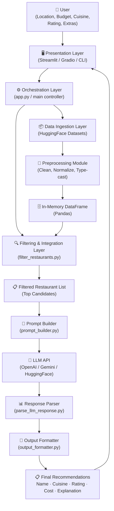
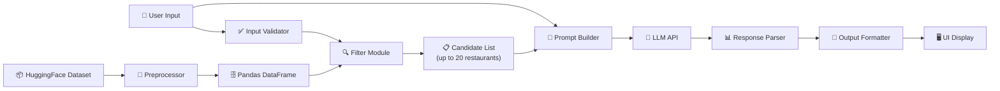
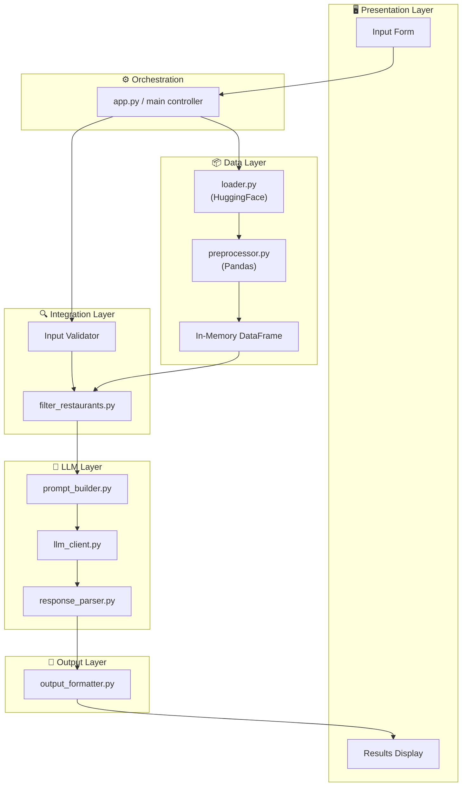
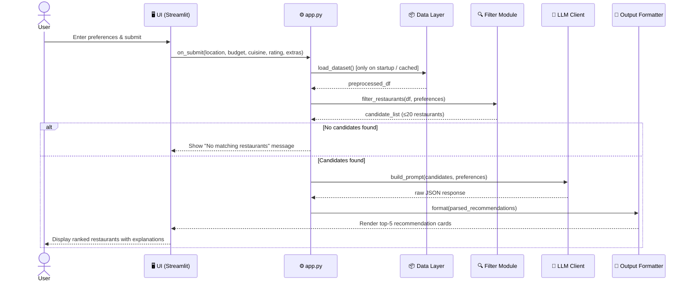

# 🏗️ Architecture: AI-Powered Restaurant Recommendation System

> **Project:** Zomato-Inspired Restaurant Recommendation Engine  
> **Based on:** [ProblemStatement.md](./ProblemStatement.md)  
> **Stack:** Python · HuggingFace Datasets · LLM API · LangChain · Streamlit

---

## 📐 Table of Contents

1. [System Overview](#1-system-overview)
2. [High-Level Architecture Diagram](#2-high-level-architecture-diagram)
3. [Layer-by-Layer Breakdown](#3-layer-by-layer-breakdown)
   - [3.1 Presentation Layer (UI)](#31-presentation-layer-ui)
   - [3.2 Application / Orchestration Layer](#32-application--orchestration-layer)
   - [3.3 Data Ingestion & Preprocessing Layer](#33-data-ingestion--preprocessing-layer)
   - [3.4 Filtering & Integration Layer](#34-filtering--integration-layer)
   - [3.5 LLM Prompt Engine (Recommendation Layer)](#35-llm-prompt-engine-recommendation-layer)
   - [3.6 Output Formatting Layer](#36-output-formatting-layer)
4. [Data Flow Diagram](#4-data-flow-diagram)
5. [Component Diagram](#5-component-diagram)
6. [Sequence Diagram](#6-sequence-diagram)
7. [Module Structure (File Layout)](#7-module-structure-file-layout)
8. [Data Model](#8-data-model)
9. [Prompt Engineering Design](#9-prompt-engineering-design)
10. [Error Handling & Edge Cases](#10-error-handling--edge-cases)
11. [Tech Stack Reference](#11-tech-stack-reference)
12. [Design Decisions & Tradeoffs](#12-design-decisions--tradeoffs)

---

## 1. System Overview

The system is a **multi-layer AI application** that blends classical data filtering with LLM-powered natural language generation. It follows a **pipeline architecture** where each stage transforms inputs into progressively richer outputs:

```
Raw Dataset → Preprocessed DataFrame → Filtered Results → LLM Prompt → Ranked Recommendations
```

The core idea is:
- **Structured filtering** (Python/Pandas) handles the heavy lifting of narrowing 1000s of restaurants down to relevant candidates
- **LLM reasoning** then adds the human-like layer — ranking, explaining, and summarizing those candidates based on nuanced user preferences

---

## 2. High-Level Architecture Diagram



---

## 3. Layer-by-Layer Breakdown

### 3.1 Presentation Layer (UI)

**Purpose:** Collect user preferences and display final recommendations.

**Options:**
| UI Option | Use Case | Complexity |
|---|---|---|
| **Streamlit** | Web app with interactive widgets | Low |
| **Gradio** | Quick demo / prototype | Very Low |
| **CLI** | Terminal-based usage, scripting | Minimal |

**Responsibilities:**
- Render input form (dropdowns, sliders, text fields)
- Validate required inputs before submission
- Display loading state while LLM processes
- Render final recommendation cards

**Input Fields:**

| Field | Widget Type | Validation |
|---|---|---|
| Location | Dropdown / Text Input | Must be non-empty |
| Budget | Radio / Select (`Low` / `Medium` / `High`) | Required |
| Cuisine | Multi-select Dropdown | Optional (defaults to all) |
| Minimum Rating | Slider (0.0 – 5.0) | Numeric, 0–5 range |
| Additional Preferences | Free-text | Optional |

---

### 3.2 Application / Orchestration Layer

**Purpose:** Acts as the central controller — coordinates all other layers.

**File:** `app.py` or `main.py`

**Responsibilities:**
- Initialize dataset on startup (load once, cache)
- Receive validated user input from UI
- Invoke the filtering module
- Invoke the prompt builder and LLM client
- Pass LLM response to the output formatter
- Return structured results to the UI

**Key Design Pattern:** _Facade_ — the orchestration layer hides the complexity of each sub-module from the UI.

```
app.py
 ├── on_startup()       → load_dataset(), preprocess()
 ├── on_user_submit()   → filter() → build_prompt() → call_llm() → format_output()
 └── on_render()        → display results
```

---

### 3.3 Data Ingestion & Preprocessing Layer

**Purpose:** Load the Zomato dataset and produce a clean, query-ready DataFrame.

**Source:** [HuggingFace — ManikaSaini/zomato-restaurant-recommendation](https://huggingface.co/datasets/ManikaSaini/zomato-restaurant-recommendation)

**Files:** `data/loader.py`, `data/preprocessor.py`

#### 3.3.1 Ingestion Steps

```python
from datasets import load_dataset

dataset = load_dataset("ManikaSaini/zomato-restaurant-recommendation")
df = dataset["train"].to_pandas()
```

#### 3.3.2 Preprocessing Steps

| Step | Operation | Detail |
|---|---|---|
| **1. Column Selection** | Keep only relevant fields | `name`, `location`, `cuisines`, `approx_cost`, `aggregate_rating` |
| **2. Rename Columns** | Standardize names | `approx_cost` → `cost`, `aggregate_rating` → `rating` |
| **3. Type Casting** | Convert to correct types | `cost` → `int`, `rating` → `float` |
| **4. Null Handling** | Drop or fill missing values | Drop rows missing `name` or `location`; fill rating NaN with 0.0 |
| **5. Cost Normalization** | Map cost to budget tier | `≤500` → Low, `501–1200` → Medium, `>1200` → High |
| **6. Text Normalization** | Lowercase & strip whitespace | `location`, `cuisines` |
| **7. Deduplication** | Remove exact duplicates | Based on `name` + `location` |

#### 3.3.3 Output Schema

```python
{
  "name":     str,    # Restaurant name
  "location": str,    # City / area (normalized, lowercase)
  "cuisines": str,    # Comma-separated cuisine types
  "cost":     int,    # Approx cost for two (INR)
  "budget":   str,    # "low" | "medium" | "high"
  "rating":   float,  # Aggregate rating (0.0 – 5.0)
}
```

---

### 3.4 Filtering & Integration Layer

**Purpose:** Narrow down the full dataset to a relevant candidate set (pre-LLM filtering).

**File:** `services/filter_restaurants.py`

**Why filter before LLM?**
- LLMs have token limits — sending 5000 restaurants is not feasible
- Structured filtering is fast, deterministic, and cheap
- Reduces LLM hallucination risk by providing only relevant context

#### 3.4.1 Filtering Logic

```python
def filter_restaurants(df, location, budget, cuisines, min_rating):
    filtered = df.copy()

    # 1. Location filter (case-insensitive substring match)
    filtered = filtered[filtered["location"].str.contains(location.lower())]

    # 2. Budget filter
    filtered = filtered[filtered["budget"] == budget.lower()]

    # 3. Cuisine filter (if provided)
    if cuisines:
        pattern = "|".join([c.lower() for c in cuisines])
        filtered = filtered[filtered["cuisines"].str.contains(pattern)]

    # 4. Minimum rating filter
    filtered = filtered[filtered["rating"] >= min_rating]

    # 5. Sort by rating descending, take top N candidates
    filtered = filtered.sort_values("rating", ascending=False).head(20)

    return filtered
```

#### 3.4.2 Fallback Strategy

| Scenario | Fallback Action |
|---|---|
| No results after all filters | Relax cuisine filter, retry |
| Still no results | Relax budget filter, retry |
| Still no results | Return empty and surface "no match" message to user |

---

### 3.5 LLM Prompt Engine (Recommendation Layer)

**Purpose:** Convert the filtered restaurant list into a structured LLM prompt and retrieve ranked recommendations with explanations.

**Files:** `services/prompt_builder.py`, `services/llm_client.py`, `services/response_parser.py`

#### 3.5.1 Prompt Architecture

The prompt follows a **System + User** message pattern (compatible with OpenAI Chat API, Gemini, etc.):

```
┌─────────────────────────────────────────────────┐
│  SYSTEM PROMPT                                  │
│  - Role: Expert restaurant recommender          │
│  - Task: Rank and explain from given list       │
│  - Output format: strict JSON                   │
├─────────────────────────────────────────────────┤
│  USER PROMPT                                    │
│  - User preferences (structured)               │
│  - Candidate restaurant data (serialized)       │
│  - Instruction to return top 5 with reasons     │
└─────────────────────────────────────────────────┘
```

#### 3.5.2 System Prompt Template

```
You are an expert restaurant recommendation assistant. 
Your job is to rank restaurants from the provided list based on the user's preferences.

Rules:
- Only recommend restaurants from the provided list. Do not invent restaurants.
- Return exactly the top 5 restaurants ranked by best fit.
- For each, provide a concise explanation (1–2 sentences) of why it suits the user.
- Respond ONLY in valid JSON format as specified.
```

#### 3.5.3 User Prompt Template

```
User Preferences:
- Location: {location}
- Budget: {budget}
- Preferred Cuisine: {cuisine}
- Minimum Rating: {min_rating}
- Additional Notes: {extras}

Available Restaurants:
{serialized_restaurant_list}

Return the top 5 recommendations in this JSON format:
[
  {{
    "rank": 1,
    "name": "...",
    "cuisine": "...",
    "rating": ...,
    "cost": ...,
    "explanation": "..."
  }},
  ...
]
```

#### 3.5.4 LLM Client Abstraction

The LLM client is abstracted to support multiple backends:

```python
class LLMClient:
    def __init__(self, provider: str):  # "openai" | "gemini" | "huggingface"
        ...

    def complete(self, system_prompt: str, user_prompt: str) -> str:
        ...
```

| Provider | Model | API |
|---|---|---|
| OpenAI | `gpt-4o` / `gpt-3.5-turbo` | OpenAI Chat Completions API |
| Google | `gemini-1.5-flash` / `gemini-pro` | Google Generative AI SDK |
| HuggingFace | `mistralai/Mixtral-8x7B-Instruct` | HF Inference API |

#### 3.5.5 Response Parsing

```python
def parse_llm_response(raw_response: str) -> list[dict]:
    # Extract JSON block from response
    # Validate fields: rank, name, cuisine, rating, cost, explanation
    # Return structured list of recommendation dicts
```

---

### 3.6 Output Formatting Layer

**Purpose:** Transform parsed LLM output into user-friendly display components.

**File:** `services/output_formatter.py`

**Output Card Per Restaurant:**

```
┌──────────────────────────────────────────────────────┐
│  🥇  Rank #1 — The Spice Garden                      │
│  🍛  Cuisine : North Indian, Mughlai                 │
│  ⭐  Rating  : 4.5 / 5.0                             │
│  💰  Est. Cost: ₹800 for two (Medium Budget)         │
│  🤖  Why?    : "A top-rated North Indian spot in     │
│                Delhi with great value for money,     │
│                perfect for your family outing."      │
└──────────────────────────────────────────────────────┘
```

---

## 4. Data Flow Diagram



---

## 5. Component Diagram



---

## 6. Sequence Diagram



---

## 7. Module Structure (File Layout)

```
zomato-recommendation/
│
├── app.py                        # Main entry point / Streamlit app
├── requirements.txt              # Python dependencies
├── .env                          # API keys (LLM provider)
├── .env.example                  # Template for .env
│
├── data/
│   ├── loader.py                 # HuggingFace dataset loader
│   └── preprocessor.py          # Cleaning, normalization, type-casting
│
├── services/
│   ├── filter_restaurants.py     # Structured filtering logic
│   ├── prompt_builder.py         # System + user prompt construction
│   ├── llm_client.py             # LLM API abstraction (OpenAI / Gemini / HF)
│   ├── response_parser.py        # Parse + validate LLM JSON output
│   └── output_formatter.py       # Format recommendations for display
│
├── models/
│   └── restaurant.py             # Restaurant dataclass / schema
│
├── config/
│   └── settings.py               # App config (LLM provider, top_n, budget map)
│
├── utils/
│   ├── validators.py             # Input validation helpers
│   └── logger.py                 # Logging setup
│
├── tests/
│   ├── test_preprocessor.py
│   ├── test_filter.py
│   ├── test_prompt_builder.py
│   └── test_response_parser.py
│
└── doc/
    ├── ProblemStatement.md
    └── architecture.md           # ← This file
```

---

## 8. Data Model

### 8.1 `Restaurant` (Internal Model)

```python
from dataclasses import dataclass

@dataclass
class Restaurant:
    name:     str
    location: str
    cuisines: str
    cost:     int       # INR for two
    budget:   str       # "low" | "medium" | "high"
    rating:   float     # 0.0 – 5.0
```

### 8.2 `UserPreferences` (Input Model)

```python
@dataclass
class UserPreferences:
    location:    str
    budget:      str          # "low" | "medium" | "high"
    cuisines:    list[str]    # e.g. ["Italian", "Chinese"]
    min_rating:  float        # e.g. 4.0
    extras:      str          # free-text additional notes
```

### 8.3 `Recommendation` (Output Model)

```python
@dataclass
class Recommendation:
    rank:        int
    name:        str
    cuisine:     str
    rating:      float
    cost:        int
    explanation: str    # LLM-generated natural language reason
```

### 8.4 Budget Mapping

| User Budget | Cost Range (INR for two) |
|---|---|
| `low` | ≤ ₹500 |
| `medium` | ₹501 – ₹1,200 |
| `high` | > ₹1,200 |

---

## 9. Prompt Engineering Design

### 9.1 Key Principles

| Principle | Implementation |
|---|---|
| **Grounding** | Only pass restaurants from filtered list; explicitly forbid invention |
| **Structured Output** | Instruct LLM to return strict JSON (enables reliable parsing) |
| **Conciseness** | Limit candidate list to top 20 (token budget management) |
| **Contextual Richness** | Include user `extras` field to allow nuanced LLM reasoning |
| **Fallback** | If JSON parsing fails, retry with stricter format instruction |

### 9.2 Token Budget Estimation

| Component | Estimated Tokens |
|---|---|
| System prompt | ~150 |
| User preferences | ~80 |
| 20 restaurants (serialized) | ~1,200 |
| Output (5 recommendations + explanations) | ~600 |
| **Total** | **~2,030 tokens** |

> Well within the context window of GPT-4o (128K), Gemini 1.5 Flash (1M), or Mistral-7B (32K).

### 9.3 Retry & Fallback

```
LLM Response Received
        │
        ▼
   Valid JSON? ──── No ──→ Retry with stricter prompt (max 2 retries)
        │                           │
       Yes                    Still invalid?
        │                           │
        ▼                           ▼
  Parse & Return          Return raw text response
                          with warning to user
```

---

## 10. Error Handling & Edge Cases

| Scenario | Handling Strategy |
|---|---|
| **No matching restaurants** | Relax filters (cuisine → budget), show "no match" if still empty |
| **LLM API timeout** | Retry with exponential backoff (max 3 attempts) |
| **Invalid JSON from LLM** | Retry with stricter prompt; fall back to raw text display |
| **Missing dataset fields** | Fill with defaults during preprocessing (rating=0.0, cost=0) |
| **Invalid user input** | Validate before calling filter; surface clear error messages in UI |
| **LLM hallucination** | Post-process: verify all LLM-returned restaurant names exist in candidate list |
| **API key missing** | Check at startup; surface `.env` setup instructions |

---

## 11. Tech Stack Reference

| Layer | Technology | Purpose |
|---|---|---|
| **Dataset** | `datasets` (HuggingFace) | Load Zomato restaurant data |
| **Data Processing** | `pandas` | DataFrame operations, filtering |
| **LLM — OpenAI** | `openai` Python SDK | GPT-4o / GPT-3.5 completions |
| **LLM — Google** | `google-generativeai` | Gemini Pro / Flash completions |
| **LLM — HuggingFace** | `huggingface_hub` | Inference API for open models |
| **Prompt Orchestration** | `langchain` *(optional)* | Prompt templates, chains, retry |
| **UI** | `streamlit` | Interactive web application |
| **Config / Secrets** | `python-dotenv` | Load API keys from `.env` |
| **Testing** | `pytest` | Unit tests for each module |
| **Logging** | `logging` (stdlib) | Debug and error tracking |

### `requirements.txt`

```
datasets>=2.18.0
pandas>=2.0.0
openai>=1.30.0
google-generativeai>=0.5.0
huggingface-hub>=0.22.0
langchain>=0.2.0
streamlit>=1.35.0
python-dotenv>=1.0.0
pytest>=8.0.0
```

---

## 12. Design Decisions & Tradeoffs

| Decision | Chosen Approach | Alternative | Reason |
|---|---|---|---|
| **Pre-LLM Filtering** | Pandas filter before LLM | Send all data to LLM | Token cost, speed, reliability |
| **LLM Output Format** | JSON | Free text | Easier parsing, less brittle |
| **Dataset Loading** | Load once at startup, cache in memory | Re-load on every request | Performance — dataset is static |
| **LLM Provider** | Abstracted (pluggable) | Hardcoded to one provider | Flexibility for different API keys |
| **Top-N Candidates to LLM** | 20 restaurants | All filtered results | Token budget management |
| **UI Framework** | Streamlit | FastAPI + React | Speed of development for prototype |
| **Budget Mapping** | Tiered (low/med/high) | Exact price range | More intuitive for end users |
| **Cuisine Matching** | Substring match | Exact match | More forgiving UX ("Indian" matches "North Indian") |

---

> 💡 **Next Steps:** After validating the architecture with a prototype, consider adding a vector database (e.g., ChromaDB, Pinecone) for semantic search over restaurant descriptions, and a feedback loop to improve ranking over time.

