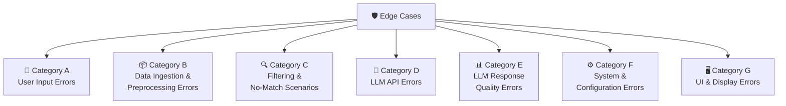

# 🛡️ Edge Cases & Error Handling Guide
## AI-Powered Restaurant Recommendation System (Zomato Use Case)

> **References:** [architecture.md](./architecture.md) · [ImplementationPlan.md](./ImplementationPlan.md)  
> **Coverage:** User Input · Data Layer · Filtering · LLM Layer · Output · System

---

## 📐 Table of Contents

1. [Edge Case Categories Overview](#1-edge-case-categories-overview)
2. [Category A — User Input Errors](#2-category-a--user-input-errors)
3. [Category B — Data Ingestion & Preprocessing Errors](#3-category-b--data-ingestion--preprocessing-errors)
4. [Category C — Filtering & No-Match Scenarios](#4-category-c--filtering--no-match-scenarios)
5. [Category D — LLM API Errors](#5-category-d--llm-api-errors)
6. [Category E — LLM Response Quality Errors](#6-category-e--llm-response-quality-errors)
7. [Category F — System & Configuration Errors](#7-category-f--system--configuration-errors)
8. [Category G — UI & Display Errors](#8-category-g--ui--display-errors)
9. [Master Edge Case Matrix](#9-master-edge-case-matrix)
10. [Test Cases for Each Edge Case](#10-test-cases-for-each-edge-case)
11. [Error Message Reference](#11-error-message-reference)

---

## 1. Edge Case Categories Overview



| Category | Domain | No. of Cases | Severity |
|---|---|---|---|
| **A** | User Input | 7 | Medium |
| **B** | Data Ingestion & Preprocessing | 6 | High |
| **C** | Filtering & No-Match | 5 | High |
| **D** | LLM API | 5 | Critical |
| **E** | LLM Response Quality | 6 | High |
| **F** | System & Configuration | 4 | Critical |
| **G** | UI & Display | 4 | Low |

---

## 2. Category A — User Input Errors

> **Where Handled:** `utils/validators.py` → `app.py` (Streamlit UI)  
> **Principle:** Validate all input **before** invoking filtering or LLM — fail fast and surface clear messages.

---

### A-01 · Empty Location

| Field | Detail |
|---|---|
| **Description** | User submits the form without entering a location |
| **Trigger** | `prefs.location` is `""` or whitespace-only |
| **Impact** | Filter would scan entire dataset (or crash with regex error) |
| **Detected In** | `validate_preferences()` in `utils/validators.py` |
| **Handling** | Return validation error; block form submission |
| **User Message** | ⚠️ *"Location is required. Please enter a city or area."* |

```python
# utils/validators.py
if not prefs.location or not prefs.location.strip():
    errors.append("Location is required. Please enter a city or area.")
```

---

### A-02 · Invalid Budget Value

| Field | Detail |
|---|---|
| **Description** | Budget value outside `{low, medium, high}` (e.g. programmatic call with `"cheap"`) |
| **Trigger** | `prefs.budget.lower() not in {"low", "medium", "high"}` |
| **Impact** | Budget filter would silently return no results |
| **Detected In** | `validate_preferences()` |
| **Handling** | Return validation error |
| **User Message** | ⚠️ *"Budget must be one of: Low, Medium, High."* |

```python
VALID_BUDGETS = {"low", "medium", "high"}
if prefs.budget.lower() not in VALID_BUDGETS:
    errors.append("Budget must be one of: Low, Medium, High.")
```

> [!NOTE]
> In the Streamlit UI, Budget is a radio button — this edge case is only reachable via direct API/CLI calls. Still validate defensively.

---

### A-03 · Rating Out of Range

| Field | Detail |
|---|---|
| **Description** | Minimum rating is negative or above 5.0 |
| **Trigger** | `prefs.min_rating < 0.0` or `prefs.min_rating > 5.0` |
| **Impact** | `< 0` returns all restaurants (no filtering); `> 5.0` returns empty always |
| **Detected In** | `validate_preferences()` |
| **Handling** | Clamp or reject; surface validation error |
| **User Message** | ⚠️ *"Minimum rating must be between 0.0 and 5.0."* |

```python
if not (0.0 <= prefs.min_rating <= 5.0):
    errors.append("Minimum rating must be between 0.0 and 5.0.")
```

---

### A-04 · Location With Special Regex Characters

| Field | Detail |
|---|---|
| **Description** | User enters a location with regex metacharacters — e.g. `"Delhi (NCR)"`, `"St. Xavier's+"` |
| **Trigger** | `str.contains(location)` raises `re.error` |
| **Impact** | Unhandled exception crashes the filter module |
| **Detected In** | `filter_restaurants.py` |
| **Handling** | Escape the location string with `re.escape()` before passing to `str.contains()` |
| **User Message** | None needed (transparent fix) |

```python
import re
# services/filter_restaurants.py
safe_location = re.escape(prefs.location.lower())
filtered = filtered[filtered["location"].str.contains(safe_location, na=False)]
```

---

### A-05 · Extremely Long Free-Text Extras

| Field | Detail |
|---|---|
| **Description** | User pastes a very long paragraph into the "Additional Preferences" text area |
| **Trigger** | `len(prefs.extras) > 500` characters |
| **Impact** | Inflates LLM token count significantly; may exceed token limit on smaller models |
| **Detected In** | `validate_preferences()` or `prompt_builder.py` |
| **Handling** | Truncate extras to 300 characters with a notice; or reject with a character limit warning |
| **User Message** | ⚠️ *"Additional preferences exceed 300 characters. Please shorten your input."* |

```python
MAX_EXTRAS_LEN = 300
if prefs.extras and len(prefs.extras) > MAX_EXTRAS_LEN:
    prefs.extras = prefs.extras[:MAX_EXTRAS_LEN]  # Silent truncation
    # Or: errors.append("Additional preferences must be under 300 characters.")
```

---

### A-06 · All Filters Simultaneously Too Restrictive

| Field | Detail |
|---|---|
| **Description** | User sets rating = 5.0, budget = low, a rare cuisine, and a small city |
| **Trigger** | Combination of filters yields 0 candidates even after fallbacks |
| **Impact** | Empty results returned; LLM not called |
| **Detected In** | `filter_restaurants()` after all fallback levels |
| **Handling** | Return empty list; UI shows "no match" warning with suggestions to relax filters |
| **User Message** | 😕 *"No restaurants found matching all your criteria. Try lowering the minimum rating or broadening the cuisine selection."* |

---

### A-07 · No Cuisine Selected (Empty Multi-Select)

| Field | Detail |
|---|---|
| **Description** | User submits without selecting any cuisine from the multi-select |
| **Trigger** | `prefs.cuisines == []` |
| **Impact** | None — this is valid. No cuisine filter should be applied (return all cuisines) |
| **Detected In** | `filter_restaurants.py` |
| **Handling** | Skip the cuisine filter step entirely when `cuisines` is empty |
| **User Message** | None — cuisine is optional by design |

```python
# services/filter_restaurants.py
if prefs.cuisines and not relax_cuisine:   # Only filter if list is non-empty
    pattern = "|".join([c.lower() for c in prefs.cuisines])
    filtered = filtered[filtered["cuisines"].str.contains(pattern, na=False)]
```

---

## 3. Category B — Data Ingestion & Preprocessing Errors

> **Where Handled:** `data/loader.py`, `data/preprocessor.py`  
> **Principle:** Defensive preprocessing — log warnings, fill safe defaults, never crash on dirty data.

---

### B-01 · HuggingFace Dataset Download Failure

| Field | Detail |
|---|---|
| **Description** | Network unavailable or dataset path is renamed/moved on HuggingFace Hub |
| **Trigger** | `load_dataset("ManikaSaini/zomato-restaurant-recommendation")` raises `ConnectionError` or `DatasetNotFoundError` |
| **Impact** | App cannot start — no data |
| **Detected In** | `data/loader.py` |
| **Handling** | Catch exception; display startup error; optionally fall back to a locally cached CSV |
| **User Message** | ❌ *"Failed to load the dataset. Please check your internet connection or contact support."* |

```python
# data/loader.py
try:
    dataset = load_dataset("ManikaSaini/zomato-restaurant-recommendation")
except Exception as e:
    logger.critical(f"Dataset load failed: {e}")
    raise RuntimeError("Could not load the Zomato dataset from HuggingFace.") from e
```

---

### B-02 · Missing or Renamed Columns in Dataset

| Field | Detail |
|---|---|
| **Description** | HuggingFace dataset schema changes and expected columns (e.g. `approx_cost(for two people)`, `rate`) are absent |
| **Trigger** | `KeyError` when selecting columns in preprocessor |
| **Impact** | Preprocessing crashes entirely |
| **Detected In** | `data/preprocessor.py` — Step 1 (Column Selection) |
| **Handling** | Verify required columns exist before selecting; log a detailed error listing missing columns |
| **User Message** | ❌ *"Dataset schema mismatch. Please contact the developer."* |

```python
REQUIRED_COLS = ["name", "location", "cuisines"]
missing = [c for c in REQUIRED_COLS if c not in df.columns]
if missing:
    raise ValueError(f"Dataset missing required columns: {missing}. Found: {df.columns.tolist()}")
```

---

### B-03 · Null Values in Critical Fields

| Field | Detail |
|---|---|
| **Description** | Rows with `NaN` in `name` or `location` — restaurants that can't be identified or located |
| **Trigger** | `df["name"].isna()` or `df["location"].isna()` |
| **Impact** | Filter errors (NaN location breaks `str.contains`); display errors (NaN name) |
| **Detected In** | `data/preprocessor.py` — Step 4 (Null Handling) |
| **Handling** | Drop rows where `name` or `location` is null; fill `rating` with `0.0`; fill `cuisines` with `""` |

```python
df.dropna(subset=["name", "location"], inplace=True)
df["rating"]   = df["rating"].fillna(0.0)
df["cuisines"] = df["cuisines"].fillna("")
df["cost"]     = df["cost"].fillna(0).astype(int)
```

---

### B-04 · Non-Numeric Cost or Rating Values

| Field | Detail |
|---|---|
| **Description** | Cost field contains strings like `"800-1000"`, `"N/A"`, `","` — not directly castable to int |
| **Trigger** | `int("800-1000")` raises `ValueError` |
| **Impact** | Budget tier mapping fails; entire DataFrame corrupted |
| **Detected In** | `data/preprocessor.py` — Step 3 (Type Casting) |
| **Handling** | Use `pd.to_numeric(..., errors="coerce")` to silently convert bad values to `NaN`, then fill with 0 |

```python
# Handle cost strings like "800,900" or "1,200"
df["cost"] = pd.to_numeric(
    df["cost"].astype(str).str.replace(",", "").str.extract(r"(\d+)")[0],
    errors="coerce"
).fillna(0).astype(int)

# Handle rating strings like "4.5/5" or "NEW" or "-"
df["rating"] = pd.to_numeric(
    df["rating"].astype(str).str.split("/").str[0].str.strip(),
    errors="coerce"
).fillna(0.0)
```

---

### B-05 · Duplicate Restaurant Records

| Field | Detail |
|---|---|
| **Description** | Same restaurant name and location appears multiple times in the dataset |
| **Trigger** | `df.duplicated(subset=["name", "location"])` returns True rows |
| **Impact** | Same restaurant may appear multiple times in candidate list, wasting LLM context |
| **Detected In** | `data/preprocessor.py` — Step 7 (Deduplication) |
| **Handling** | Drop duplicates keeping the row with the highest rating |

```python
df.sort_values("rating", ascending=False, inplace=True)
df.drop_duplicates(subset=["name", "location"], keep="first", inplace=True)
df.reset_index(drop=True, inplace=True)
```

---

### B-06 · Entire Dataset is Empty After Preprocessing

| Field | Detail |
|---|---|
| **Description** | After dropping nulls and deduplication, the DataFrame has 0 rows |
| **Trigger** | Extreme data quality issues in the loaded dataset |
| **Impact** | App starts but all queries return empty results |
| **Detected In** | `data/preprocessor.py` — after all preprocessing steps |
| **Handling** | Log a critical error; raise `RuntimeError` to prevent silent failure |

```python
if df.empty:
    raise RuntimeError("DataFrame is empty after preprocessing. Check the dataset.")
logger.info(f"Preprocessing complete. {len(df)} clean records ready.")
```

---

## 4. Category C — Filtering & No-Match Scenarios

> **Where Handled:** `services/filter_restaurants.py`  
> **Principle:** Never return an empty result without exhausting all fallbacks. Always log which fallback level was used.

---

### C-01 · Location Not Found in Dataset

| Field | Detail |
|---|---|
| **Description** | User enters a location that exists nowhere in the dataset (e.g. `"Shimla"`, `"Kochi"` if dataset only covers metros) |
| **Trigger** | `df["location"].str.contains("shimla")` returns all `False` |
| **Impact** | Zero candidates even before other filters |
| **Fallback** | None — location is never relaxed (too imprecise otherwise) |
| **Handling** | Return empty DataFrame; UI shows "no restaurants found in this location" |
| **User Message** | 😕 *"No restaurants found in '{location}'. Try a nearby major city."* |

---

### C-02 · No Restaurants Match Budget Tier

| Field | Detail |
|---|---|
| **Description** | Location exists but no restaurants fall in the chosen budget tier |
| **Trigger** | After location filter, `budget` filter returns 0 rows |
| **Impact** | Zero candidates |
| **Fallback** | Level 2 — relax budget filter (accept all budget tiers) |
| **Handling** | Retry without budget constraint; log fallback activation |
| **User Message** | None visible (transparent retry) |

```python
# Fallback Level 1: relax cuisine only
result = _apply_filters(df, prefs, relax_cuisine=True, relax_budget=False)

# Fallback Level 2: relax both cuisine and budget
if result.empty:
    result = _apply_filters(df, prefs, relax_cuisine=True, relax_budget=True)
```

---

### C-03 · Cuisine Not Found in Location

| Field | Detail |
|---|---|
| **Description** | User requests `"Italian"` in a location where only `"North Indian"` restaurants exist |
| **Trigger** | After location + budget filter, cuisine filter returns 0 rows |
| **Impact** | Zero candidates |
| **Fallback** | Level 1 — relax cuisine filter |
| **Handling** | Retry without cuisine constraint; LLM receives all cuisines from that location |
| **User Message** | None visible (transparent retry) |

---

### C-04 · Minimum Rating Too High

| Field | Detail |
|---|---|
| **Description** | User sets minimum rating = 5.0 but no restaurant in the location has a perfect score |
| **Trigger** | `df["rating"] >= 5.0` returns 0 rows after all other filters |
| **Impact** | Zero candidates after all fallbacks (location is still applied) |
| **Fallback** | After all 3 filter levels fail, return empty |
| **Handling** | Return empty; UI suggests lowering the rating slider |
| **User Message** | 😕 *"No restaurants with a rating of 5.0 found. Try lowering your minimum rating."* |

---

### C-05 · Fewer Than 5 Candidates Available

| Field | Detail |
|---|---|
| **Description** | Filters return only 1–4 restaurants — fewer than the 5 recommendations the LLM is asked to produce |
| **Trigger** | `len(candidates) < 5` |
| **Impact** | LLM may invent restaurants to pad the response to 5 (hallucination) |
| **Detected In** | `services/prompt_builder.py` + `services/response_parser.py` |
| **Handling** | Adjust system prompt to say "Return up to `{n}` recommendations"; hallucination check in parser will catch any invented names |
| **User Message** | ℹ️ *"Only {n} restaurant(s) match your criteria — showing all available."* |

```python
# services/prompt_builder.py
top_n = min(5, len(candidates))
# Adjust prompt: "Return exactly the top {top_n} restaurants..."
```

---

## 5. Category D — LLM API Errors

> **Where Handled:** `services/llm_client.py`  
> **Principle:** Retry with exponential backoff; always raise a clean error after max retries rather than silently returning empty/broken output.

---

### D-01 · API Key Missing or Invalid

| Field | Detail |
|---|---|
| **Description** | `OPENAI_API_KEY` / `GOOGLE_API_KEY` / `HUGGINGFACE_TOKEN` not set in `.env` or is invalid |
| **Trigger** | API returns `401 Unauthorized` or `AuthenticationError` |
| **Impact** | All LLM calls fail; app is non-functional |
| **Detected In** | `config/settings.py` at startup + `llm_client.py` on first call |
| **Handling** | Check key presence at startup; surface clear setup instructions |
| **User Message** | ❌ *"LLM API key not configured. Please add your key to the `.env` file and restart."* |

```python
# config/settings.py — startup check
if LLM_PROVIDER == "openai" and not OPENAI_API_KEY:
    raise EnvironmentError(
        "OPENAI_API_KEY is not set. Copy .env.example to .env and add your key."
    )
```

---

### D-02 · API Request Timeout

| Field | Detail |
|---|---|
| **Description** | LLM API takes too long to respond (network latency, model overload) |
| **Trigger** | `httpx.TimeoutException`, `openai.Timeout`, `requests.Timeout` |
| **Impact** | User waits indefinitely or request hangs |
| **Detected In** | `llm_client.py` — `_call()` method |
| **Handling** | Set explicit timeouts (30s); retry with exponential backoff up to 3 times |
| **User Message** | ⏳ *"The AI service is taking too long. Please try again."* |

```python
# llm_client.py — set timeout
response = self.client.chat.completions.create(
    model="gpt-4o",
    messages=[...],
    timeout=30.0   # 30 second timeout
)
```

---

### D-03 · Rate Limit Exceeded (429)

| Field | Detail |
|---|---|
| **Description** | Too many requests to the LLM API in a short window |
| **Trigger** | `429 Too Many Requests` / `openai.RateLimitError` |
| **Impact** | Request fails; user sees error |
| **Detected In** | `llm_client.py` — `complete()` retry loop |
| **Handling** | Catch `RateLimitError` specifically; retry after longer delay (read `Retry-After` header if available) |
| **User Message** | ⏳ *"AI service is busy. Retrying in a moment..."* |

```python
import time
for attempt in range(1, retries + 1):
    try:
        return self._call(system_prompt, user_prompt)
    except RateLimitError:
        wait = 2 ** attempt * 2   # 4s, 8s, 16s
        logger.warning(f"Rate limited. Waiting {wait}s before retry {attempt}.")
        time.sleep(wait)
```

---

### D-04 · LLM API Returns Empty Response

| Field | Detail |
|---|---|
| **Description** | API call succeeds (200 OK) but response content is empty string or `None` |
| **Trigger** | `response.choices[0].message.content` is `""` or `None` |
| **Impact** | Parser receives empty string; JSON parse fails |
| **Detected In** | `llm_client.py` — after `_call()` returns |
| **Handling** | Check for empty response; treat as failure and retry |

```python
result = self._call(system_prompt, user_prompt)
if not result or not result.strip():
    raise ValueError("LLM returned an empty response.")
return result
```

---

### D-05 · Unknown LLM Provider Configured

| Field | Detail |
|---|---|
| **Description** | `LLM_PROVIDER` in `.env` set to an unrecognized value (e.g. `"claude"`, `"anthropic"`) |
| **Trigger** | `LLMClient._init_client()` hits the `else` branch |
| **Impact** | App fails to start; no LLM client initialized |
| **Detected In** | `llm_client.py` — `_init_client()` |
| **Handling** | Raise `ValueError` with list of valid providers |
| **User Message** | ❌ *"Unknown LLM provider: 'claude'. Valid options are: openai, gemini, huggingface."* |

```python
else:
    raise ValueError(
        f"Unknown LLM provider: '{self.provider}'. "
        f"Valid options: openai, gemini, huggingface"
    )
```

---

## 6. Category E — LLM Response Quality Errors

> **Where Handled:** `services/response_parser.py`  
> **Principle:** Never trust raw LLM output. Always validate structure, types, and content grounding.

---

### E-01 · LLM Returns Invalid JSON

| Field | Detail |
|---|---|
| **Description** | LLM response is not valid JSON — free text, partial JSON, or truncated output |
| **Trigger** | `json.loads(raw)` raises `json.JSONDecodeError` |
| **Impact** | No recommendations can be extracted |
| **Detected In** | `response_parser.py` — `parse_llm_response()` |
| **Handling** | Retry with a stricter prompt appending: *"Respond with ONLY valid JSON. No explanation, no markdown."*; fall back to raw text display after 2 retries |
| **User Message** | ⚠️ *"AI response could not be parsed. Here is the raw output: [raw text]"* |

```python
# response_parser.py
try:
    data = json.loads(json_str)
except json.JSONDecodeError as e:
    logger.error(f"JSON parse failed: {e}")
    raise ValueError("LLM returned invalid JSON.") from e
```

---

### E-02 · LLM Response Wrapped in Markdown Code Fence

| Field | Detail |
|---|---|
| **Description** | LLM wraps its JSON in ` ```json ... ``` ` despite being instructed not to |
| **Trigger** | Raw response starts with ` ```json ` or ` ``` ` |
| **Impact** | `json.loads()` fails on the raw string |
| **Detected In** | `response_parser.py` — `_extract_json()` |
| **Handling** | Strip markdown code fences with regex before parsing (already implemented in `_extract_json()`) |
| **User Message** | None — transparent fix |

```python
def _extract_json(raw: str) -> str:
    match = re.search(r"```(?:json)?\s*([\s\S]*?)```", raw)
    if match:
        return match.group(1).strip()
    match = re.search(r"\[[\s\S]*\]", raw)
    if match:
        return match.group(0)
    return raw.strip()
```

---

### E-03 · LLM Hallucination — Invented Restaurant Name

| Field | Detail |
|---|---|
| **Description** | LLM returns a restaurant name that was **not** in the candidate list passed in the prompt |
| **Trigger** | `item["name"] not in candidate_names` |
| **Impact** | Recommendation points to a non-existent or incorrect restaurant |
| **Detected In** | `response_parser.py` — hallucination check loop |
| **Handling** | Skip the hallucinated item silently; log a warning; if all 5 are hallucinated, return `[]` |
| **User Message** | 😕 *"No valid recommendations could be verified. Please try again."* (only if all are skipped) |

```python
if item["name"] not in candidate_names:
    logger.warning(f"Hallucinated restaurant skipped: '{item['name']}'")
    continue
```

---

### E-04 · LLM Response Missing Required Fields

| Field | Detail |
|---|---|
| **Description** | JSON array is valid but individual items are missing fields like `explanation` or `rank` |
| **Trigger** | `REQUIRED_FIELDS - item.keys()` is non-empty |
| **Impact** | Cannot construct a `Recommendation` object safely |
| **Detected In** | `response_parser.py` — field validation loop |
| **Handling** | Skip the incomplete item; log missing fields |
| **User Message** | None — other complete items are still shown |

```python
REQUIRED_FIELDS = {"rank", "name", "cuisine", "rating", "cost", "explanation"}
missing = REQUIRED_FIELDS - item.keys()
if missing:
    logger.warning(f"Skipping item missing fields {missing}: {item}")
    continue
```

---

### E-05 · LLM Returns Wrong Data Types in JSON

| Field | Detail |
|---|---|
| **Description** | `rating` is a string like `"4.5"` instead of float; `cost` is `"₹800"` instead of int |
| **Trigger** | `int(item["cost"])` or `float(item["rating"])` raises `ValueError` |
| **Impact** | `Recommendation` object creation fails |
| **Detected In** | `response_parser.py` — type casting in item loop |
| **Handling** | Wrap type casts in `try/except`; skip item on type error |

```python
try:
    recommendations.append(Recommendation(
        rank=int(item["rank"]),
        name=str(item["name"]),
        cuisine=str(item["cuisine"]),
        rating=float(str(item["rating"]).replace(",", "")),
        cost=int(str(item["cost"]).replace("₹", "").replace(",", "").split()[0]),
        explanation=str(item["explanation"])
    ))
except (ValueError, TypeError, KeyError) as e:
    logger.warning(f"Skipping item due to type error: {e} — item: {item}")
    continue
```

---

### E-06 · LLM Returns Fewer Than Expected Recommendations

| Field | Detail |
|---|---|
| **Description** | LLM returns only 1–4 recommendations instead of 5 |
| **Trigger** | After parsing, `len(recommendations) < 5` |
| **Impact** | User sees fewer results than expected — acceptable but should be communicated |
| **Detected In** | `services/recommender.py` — after parsing |
| **Handling** | Return however many were parsed; UI adapts subheader to actual count |
| **User Message** | ℹ️ *"Top {n} Recommendations"* (dynamically shows actual count, not hardcoded 5) |

---

## 7. Category F — System & Configuration Errors

> **Where Handled:** `config/settings.py`, `app.py` startup  
> **Principle:** Fail loudly at startup for configuration errors — never silently degrade.

---

### F-01 · `.env` File Missing

| Field | Detail |
|---|---|
| **Description** | Developer forgot to copy `.env.example` to `.env` before running |
| **Trigger** | `load_dotenv()` finds no `.env` file; all `os.getenv()` calls return `None` |
| **Impact** | All API keys are `None`; first LLM call fails with `AuthenticationError` |
| **Detected In** | `config/settings.py` |
| **Handling** | Check if `.env` exists; if not, log a clear setup instruction |
| **User Message** | ❌ *"`.env` file not found. Copy `.env.example` to `.env` and add your API key."* |

```python
import os
from pathlib import Path

if not Path(".env").exists():
    logger.critical(".env file not found. Copy .env.example to .env and fill in your API key.")
    raise EnvironmentError(".env file is missing. See README for setup instructions.")
```

---

### F-02 · Python Version Too Old

| Field | Detail |
|---|---|
| **Description** | User runs on Python 3.8 or 3.9 — `list[str]` type hints and walrus operator may fail |
| **Trigger** | `TypeError` or `SyntaxError` on dataclass definitions using `list[str]` |
| **Impact** | Entire app fails to import |
| **Detected In** | Any module using modern type hints |
| **Handling** | Add a Python version guard in `app.py` |

```python
import sys
if sys.version_info < (3, 10):
    raise RuntimeError(
        f"Python 3.10+ required. Current version: {sys.version}. "
        "Please upgrade your Python installation."
    )
```

---

### F-03 · HuggingFace Dataset Cache Corruption

| Field | Detail |
|---|---|
| **Description** | The locally cached HuggingFace dataset files are corrupted (interrupted download) |
| **Trigger** | `load_dataset()` raises `ArrowInvalid` or `FileNotFoundError` |
| **Impact** | App cannot load data |
| **Detected In** | `data/loader.py` |
| **Handling** | Catch the error; attempt to reload with `download_mode="force_redownload"` |

```python
try:
    dataset = load_dataset("ManikaSaini/zomato-restaurant-recommendation")
except Exception:
    logger.warning("Cache may be corrupted. Attempting force redownload...")
    dataset = load_dataset(
        "ManikaSaini/zomato-restaurant-recommendation",
        download_mode="force_redownload"
    )
```

---

### F-04 · Streamlit Cache Stale After Data Update

| Field | Detail |
|---|---|
| **Description** | `@st.cache_data` caches the DataFrame on first load; if dataset changes mid-session, users see stale data |
| **Trigger** | Dataset updated upstream while app is running |
| **Impact** | Stale recommendations from old data |
| **Detected In** | `app.py` — `@st.cache_data` decorator |
| **Handling** | Set a `ttl` (time-to-live) on the cache; add a "Refresh Data" button in the sidebar |

```python
@st.cache_data(ttl=3600)  # Refresh cache every 1 hour
def get_dataframe():
    return preprocess(load_zomato_dataset())
```

---

## 8. Category G — UI & Display Errors

> **Where Handled:** `app.py`, `services/output_formatter.py`  
> **Principle:** Always render something meaningful — never show a blank screen or a raw Python traceback.

---

### G-01 · Rank Medal Missing for Ranks > 3

| Field | Detail |
|---|---|
| **Description** | `RANK_MEDALS` dict only defines medals for ranks 1, 2, 3 — ranks 4 and 5 fall through |
| **Trigger** | `RANK_MEDALS.get(rec.rank, ?)` called with `rec.rank = 4` or `5` |
| **Impact** | Medal field is empty or `None` — display inconsistency |
| **Detected In** | `services/output_formatter.py` |
| **Handling** | Provide a default fallback: `f"#{rec.rank}"` |

```python
RANK_MEDALS = {1: "🥇", 2: "🥈", 3: "🥉"}

def format_recommendation(rec):
    medal = RANK_MEDALS.get(rec.rank, f"#{rec.rank}")  # "4" → "#4", "5" → "#5"
    ...
```

---

### G-02 · Very Long Restaurant Name Breaking Card Layout

| Field | Detail |
|---|---|
| **Description** | A restaurant name is 80+ characters long, breaking the card header layout in Streamlit |
| **Trigger** | `rec.name` is extremely long |
| **Impact** | UI looks broken on smaller screens |
| **Detected In** | `services/output_formatter.py` |
| **Handling** | Truncate display name to 50 characters with ellipsis |

```python
display_name = rec.name if len(rec.name) <= 50 else rec.name[:47] + "..."
```

---

### G-03 · Unicode / Emoji in Restaurant Name Causes Display Issues

| Field | Detail |
|---|---|
| **Description** | Dataset contains restaurant names with special Unicode characters or emoji |
| **Trigger** | Characters outside standard ASCII in `rec.name` |
| **Impact** | Usually renders fine in Streamlit; edge case is broken encoding in logs |
| **Detected In** | `utils/logger.py` |
| **Handling** | Ensure logger uses `utf-8` encoding; Streamlit renders Unicode natively — no code change needed |

```python
logging.basicConfig(
    level=logging.INFO,
    format="%(asctime)s [%(levelname)s] %(name)s: %(message)s",
    handlers=[logging.StreamHandler()]  # Streamlit's stdout handles UTF-8
)
```

---

### G-04 · Recommendation Explanation is Empty String

| Field | Detail |
|---|---|
| **Description** | LLM returns a blank `explanation` field in its JSON response |
| **Trigger** | `rec.explanation == ""` |
| **Impact** | "Why this?" section renders blank — confusing UX |
| **Detected In** | `services/output_formatter.py` |
| **Handling** | Replace empty explanation with a safe default message |

```python
explanation = rec.explanation.strip() or "No explanation provided by AI."
```

---

## 9. Master Edge Case Matrix

| ID | Category | Description | Severity | Layer | Strategy |
|---|---|---|---|---|---|
| A-01 | User Input | Empty location | Medium | `validators.py` | Validate & block |
| A-02 | User Input | Invalid budget value | Medium | `validators.py` | Validate & block |
| A-03 | User Input | Rating out of 0–5 range | Medium | `validators.py` | Validate & block |
| A-04 | User Input | Regex chars in location | Medium | `filter_restaurants.py` | `re.escape()` |
| A-05 | User Input | Extras text too long | Low | `validators.py` | Truncate / warn |
| A-06 | User Input | All filters too restrictive | Medium | `filter_restaurants.py` | Fallback + warn |
| A-07 | User Input | No cuisine selected | None | `filter_restaurants.py` | Skip filter (valid) |
| B-01 | Data | HuggingFace download fails | Critical | `loader.py` | Catch + error message |
| B-02 | Data | Missing/renamed columns | High | `preprocessor.py` | Column check + error |
| B-03 | Data | Null in name/location | High | `preprocessor.py` | Drop rows + fill defaults |
| B-04 | Data | Non-numeric cost/rating | High | `preprocessor.py` | `pd.to_numeric(errors="coerce")` |
| B-05 | Data | Duplicate restaurant records | Medium | `preprocessor.py` | Drop dupes by rating |
| B-06 | Data | Empty DataFrame post-processing | Critical | `preprocessor.py` | Raise `RuntimeError` |
| C-01 | Filtering | Location not in dataset | High | `filter_restaurants.py` | Return empty + message |
| C-02 | Filtering | No results for budget tier | High | `filter_restaurants.py` | Fallback Level 2 |
| C-03 | Filtering | Cuisine not in location | High | `filter_restaurants.py` | Fallback Level 1 |
| C-04 | Filtering | Rating too high → no results | Medium | `filter_restaurants.py` | Return empty + suggest |
| C-05 | Filtering | Fewer than 5 candidates | Medium | `prompt_builder.py` | Adjust prompt `top_n` |
| D-01 | LLM API | API key missing/invalid | Critical | `settings.py` / `llm_client.py` | Startup check + error |
| D-02 | LLM API | API timeout | High | `llm_client.py` | Retry + backoff |
| D-03 | LLM API | Rate limit (429) | High | `llm_client.py` | Retry with longer delay |
| D-04 | LLM API | Empty API response | High | `llm_client.py` | Treat as failure, retry |
| D-05 | LLM API | Unknown provider configured | Critical | `llm_client.py` | Raise `ValueError` |
| E-01 | LLM Response | Invalid JSON returned | High | `response_parser.py` | Retry stricter prompt |
| E-02 | LLM Response | JSON in markdown fence | Medium | `response_parser.py` | Strip fences (`_extract_json`) |
| E-03 | LLM Response | Hallucinated restaurant | High | `response_parser.py` | Skip + warn |
| E-04 | LLM Response | Missing required fields | Medium | `response_parser.py` | Skip item + warn |
| E-05 | LLM Response | Wrong data types in JSON | Medium | `response_parser.py` | Type-safe casting + skip |
| E-06 | LLM Response | Fewer than 5 results | Low | `recommender.py` | Return as-is, adjust UI |
| F-01 | System | `.env` file missing | Critical | `settings.py` | Check + setup instructions |
| F-02 | System | Python version too old | Critical | `app.py` | Version guard |
| F-03 | System | HuggingFace cache corrupted | High | `loader.py` | Force redownload |
| F-04 | System | Streamlit cache stale | Low | `app.py` | `ttl=3600` + refresh button |
| G-01 | UI | Medal missing for rank 4/5 | Low | `output_formatter.py` | Default `f"#{rank}"` |
| G-02 | UI | Very long restaurant name | Low | `output_formatter.py` | Truncate to 50 chars |
| G-03 | UI | Unicode/emoji in names | Low | `logger.py` | UTF-8 encoding |
| G-04 | UI | Empty explanation string | Low | `output_formatter.py` | Default fallback text |

---

## 10. Test Cases for Each Edge Case

```python
# tests/test_validators.py

def test_A01_empty_location():
    prefs = UserPreferences(location="", budget="low", cuisines=[], min_rating=3.0, extras="")
    errors = validate_preferences(prefs)
    assert "Location is required" in errors[0]

def test_A02_invalid_budget():
    prefs = UserPreferences(location="Delhi", budget="cheap", cuisines=[], min_rating=3.0, extras="")
    errors = validate_preferences(prefs)
    assert any("Budget" in e for e in errors)

def test_A03_rating_out_of_range():
    prefs = UserPreferences(location="Delhi", budget="low", cuisines=[], min_rating=6.0, extras="")
    errors = validate_preferences(prefs)
    assert any("rating" in e.lower() for e in errors)

def test_A07_no_cuisine_valid():
    prefs = UserPreferences(location="Delhi", budget="low", cuisines=[], min_rating=3.0, extras="")
    errors = validate_preferences(prefs)
    assert errors == []  # No cuisine is valid
```

```python
# tests/test_preprocessor.py

def test_B03_null_name_dropped(sample_df_with_nulls):
    result = preprocess(sample_df_with_nulls)
    assert result["name"].isna().sum() == 0

def test_B04_non_numeric_cost(sample_df_with_bad_cost):
    result = preprocess(sample_df_with_bad_cost)
    assert result["cost"].dtype == int
    assert (result["cost"] >= 0).all()

def test_B05_duplicates_removed(sample_df_with_duplicates):
    result = preprocess(sample_df_with_duplicates)
    assert result.duplicated(subset=["name", "location"]).sum() == 0
```

```python
# tests/test_filter.py

def test_C01_unknown_location(clean_df):
    prefs = UserPreferences(location="XyzUnknownCity", budget="medium", cuisines=[], min_rating=3.0, extras="")
    result = filter_restaurants(clean_df, prefs)
    assert result.empty

def test_C03_fallback_relaxes_cuisine(clean_df):
    prefs = UserPreferences(location="Delhi", budget="medium", cuisines=["Icelandic"], min_rating=3.0, extras="")
    result = filter_restaurants(clean_df, prefs)
    # Should return results (cuisine relaxed) or empty (location too small) — never crash
    assert isinstance(result, pd.DataFrame)

def test_C05_fewer_than_five_candidates(clean_df):
    # Use very tight filters to get < 5
    prefs = UserPreferences(location="Delhi", budget="low", cuisines=["Italian"], min_rating=4.8, extras="")
    result = filter_restaurants(clean_df, prefs)
    assert len(result) <= 5  # Should not crash regardless of count
```

```python
# tests/test_response_parser.py

def test_E01_invalid_json_raises():
    with pytest.raises(ValueError, match="invalid JSON"):
        parse_llm_response("not json at all", candidate_names={"A"})

def test_E02_markdown_fence_stripped():
    raw = '```json\n[{"rank":1,"name":"A","cuisine":"B","rating":4.0,"cost":500,"explanation":"Good"}]\n```'
    result = parse_llm_response(raw, candidate_names={"A"})
    assert len(result) == 1
    assert result[0].name == "A"

def test_E03_hallucination_skipped():
    raw = '[{"rank":1,"name":"FakePlace","cuisine":"B","rating":4.0,"cost":500,"explanation":"OK"}]'
    result = parse_llm_response(raw, candidate_names={"RealPlace"})
    assert result == []  # Hallucinated restaurant skipped

def test_E04_missing_fields_skipped():
    raw = '[{"rank":1,"name":"A","cuisine":"B"}]'  # missing rating, cost, explanation
    result = parse_llm_response(raw, candidate_names={"A"})
    assert result == []

def test_E06_fewer_than_five_ok():
    raw = '[{"rank":1,"name":"A","cuisine":"B","rating":4.0,"cost":500,"explanation":"Good"}]'
    result = parse_llm_response(raw, candidate_names={"A"})
    assert len(result) == 1   # Only 1 returned — that's fine
```

---

## 11. Error Message Reference

A consolidated list of all user-facing error messages for consistency:

| ID | Context | Type | Message |
|---|---|---|---|
| A-01 | Location empty | `st.error()` | *"Location is required. Please enter a city or area."* |
| A-02 | Budget invalid | `st.error()` | *"Budget must be one of: Low, Medium, High."* |
| A-03 | Rating out of range | `st.error()` | *"Minimum rating must be between 0.0 and 5.0."* |
| A-05 | Extras too long | `st.warning()` | *"Additional preferences exceed 300 characters and have been trimmed."* |
| A-06 / C-01 | No results found | `st.warning()` | *"No matching restaurants found. Try lowering your minimum rating or broadening your cuisine."* |
| B-01 | Dataset load failure | `st.error()` | *"Failed to load the dataset. Check your internet connection."* |
| C-04 | Rating too high | `st.warning()` | *"No restaurants with a {min_rating} rating found. Try reducing the minimum rating."* |
| D-01 | API key missing | `st.error()` | *"LLM API key not configured. Add your key to `.env` and restart."* |
| D-02 | API timeout | `st.warning()` | *"The AI service is taking too long. Please try again."* |
| D-03 | Rate limit | `st.warning()` | *"AI service is busy. Please wait a moment and try again."* |
| D-05 | Unknown provider | `st.error()` | *"Unknown LLM provider in config. Valid options: openai, gemini, huggingface."* |
| E-01 | LLM invalid JSON | `st.warning()` | *"AI response could not be understood. Please try again."* |
| E-03 | All hallucinated | `st.warning()` | *"No valid recommendations could be verified. Please try again."* |
| F-01 | `.env` missing | Startup log + `st.error()` | *"`.env` file not found. Copy `.env.example` to `.env` and add your API key."* |
| F-02 | Python too old | Startup crash | *"Python 3.10+ required. Current: {version}."* |
| G-04 | Empty explanation | UI default | *"No explanation provided by AI."* |

---

> 💡 **Coverage Goal:** All 37 edge cases above should be covered by either a unit test (Categories A–E) or a manual verification checklist (Categories F–G). Run `pytest tests/ -v` to validate automated cases.

