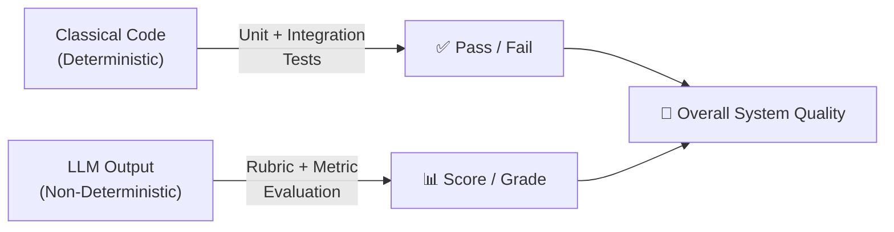
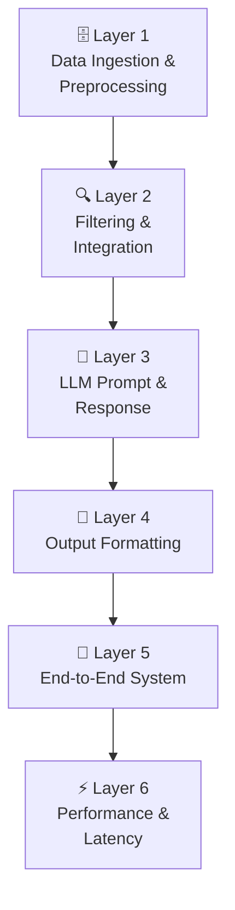

# 🧪 Evaluation Guide
## AI-Powered Restaurant Recommendation System (Zomato Use Case)

> **References:** [architecture.md](./architecture.md) · [ImplementationPlan.md](./ImplementationPlan.md) · [edge-cases.md](./edge-cases.md)  
> **Stack:** Python · Pandas · LLM API · Streamlit · pytest  
> **Scope:** Unit · Integration · LLM Quality · End-to-End · Performance

---

## 📐 Table of Contents

1. [Evaluation Philosophy](#1-evaluation-philosophy)
2. [Evaluation Layers Overview](#2-evaluation-layers-overview)
3. [Layer 1 — Data Ingestion & Preprocessing Evaluation](#3-layer-1--data-ingestion--preprocessing-evaluation)
4. [Layer 2 — Filtering & Integration Evaluation](#4-layer-2--filtering--integration-evaluation)
5. [Layer 3 — LLM Prompt & Response Evaluation](#5-layer-3--llm-prompt--response-evaluation)
6. [Layer 4 — Output Formatting Evaluation](#6-layer-4--output-formatting-evaluation)
7. [Layer 5 — End-to-End System Evaluation](#7-layer-5--end-to-end-system-evaluation)
8. [Layer 6 — Performance & Latency Evaluation](#8-layer-6--performance--latency-evaluation)
9. [Automated Test Suite](#9-automated-test-suite)
10. [Manual Evaluation Rubric](#10-manual-evaluation-rubric)
11. [LLM-Specific Evaluation Metrics](#11-llm-specific-evaluation-metrics)
12. [Evaluation Scorecards](#12-evaluation-scorecards)
13. [Regression Test Matrix](#13-regression-test-matrix)
14. [Running the Full Evaluation](#14-running-the-full-evaluation)

---

## 1. Evaluation Philosophy

This system combines **classical software** (data filtering, input validation) and **AI-generated content** (LLM recommendations). Each requires a different evaluation strategy:



| Component Type | Evaluation Approach | Tool |
|---|---|---|
| Data preprocessing | Unit tests with fixtures | `pytest` |
| Filtering logic | Parametric unit tests | `pytest` |
| Input validation | Boundary value tests | `pytest` |
| LLM prompt structure | Static analysis + token count | Manual + `tiktoken` |
| LLM response quality | Rubric scoring + hallucination rate | Manual + scripted eval |
| End-to-end flow | Scenario-based integration tests | `pytest` + manual |
| Performance | Latency profiling | `time` module / `pytest-benchmark` |
| UI | Manual walkthrough | Browser / Streamlit |

---

## 2. Evaluation Layers Overview



| Layer | What is Evaluated | Automated? | Pass Threshold |
|---|---|---|---|
| **L1 — Data** | Schema, nulls, types, deduplication, row count | ✅ Yes | 100% unit tests pass |
| **L2 — Filter** | Correctness, fallback logic, capping, edge cases | ✅ Yes | 100% unit tests pass |
| **L3 — LLM** | Prompt structure, response validity, hallucination rate, ranking quality | ⚠️ Partial | ≥90% valid JSON; ≤10% hallucination |
| **L4 — Output** | Formatting correctness, medal logic, truncation | ✅ Yes | 100% unit tests pass |
| **L5 — E2E** | Scenario coverage, acceptance criteria | ⚠️ Partial (manual) | All 6 acceptance criteria met |
| **L6 — Perf** | Preprocessing time, filter time, LLM latency, total response time | ✅ Timed | See thresholds in §8 |

---

## 3. Layer 1 — Data Ingestion & Preprocessing Evaluation

### 3.1 What to Evaluate

| Check | Description | Pass Condition |
|---|---|---|
| **Load Success** | Dataset loads from HuggingFace without error | No exception raised |
| **Row Count** | Dataset has a meaningful number of records | `len(df) > 1000` |
| **Required Columns** | All expected columns exist post-preprocessing | `{"name","location","cuisines","cost","budget","rating"} ⊆ df.columns` |
| **No Null Names** | `name` column has zero nulls | `df["name"].isna().sum() == 0` |
| **No Null Locations** | `location` column has zero nulls | `df["location"].isna().sum() == 0` |
| **Rating Range** | All ratings within 0.0–5.0 | `df["rating"].between(0.0, 5.0).all()` |
| **Cost Non-Negative** | All cost values ≥ 0 | `(df["cost"] >= 0).all()` |
| **Budget Values** | Budget column only contains valid tiers | `df["budget"].isin({"low","medium","high"}).all()` |
| **No Duplicates** | No exact (name, location) duplicates | `df.duplicated(subset=["name","location"]).sum() == 0` |
| **Text Normalized** | Location is lowercase and stripped | `df["location"].eq(df["location"].str.lower().str.strip()).all()` |

### 3.2 Unit Tests

```python
# tests/test_preprocessor.py

import pytest
import pandas as pd
from data.preprocessor import preprocess

@pytest.fixture
def raw_df():
    """Minimal synthetic raw dataset mimicking HuggingFace structure."""
    return pd.DataFrame({
        "name":    ["Spice Garden", "Pizza Hub", "Spice Garden", None, "Cafe Blend"],
        "location": ["Delhi", "Bangalore", "Delhi", "Mumbai", "  Chennai  "],
        "cuisines": ["North Indian", "Italian", None, "Chinese", "Cafe"],
        "approx_cost(for two people)": ["800", "1,500", "800", "N/A", "300"],
        "rate": ["4.2/5", "3.8/5", "4.2/5", "NEW", "4.7/5"],
    })

def test_required_columns_present(raw_df):
    result = preprocess(raw_df)
    required = {"name", "location", "cuisines", "cost", "budget", "rating"}
    assert required.issubset(result.columns), f"Missing columns: {required - set(result.columns)}"

def test_null_names_dropped(raw_df):
    result = preprocess(raw_df)
    assert result["name"].isna().sum() == 0

def test_duplicates_removed(raw_df):
    result = preprocess(raw_df)
    assert result.duplicated(subset=["name", "location"]).sum() == 0

def test_rating_within_range(raw_df):
    result = preprocess(raw_df)
    assert result["rating"].between(0.0, 5.0).all()

def test_cost_non_negative(raw_df):
    result = preprocess(raw_df)
    assert (result["cost"] >= 0).all()

def test_budget_valid_values(raw_df):
    result = preprocess(raw_df)
    assert result["budget"].isin({"low", "medium", "high"}).all()

def test_location_normalized(raw_df):
    result = preprocess(raw_df)
    # "  Chennai  " should become "chennai"
    assert "chennai" in result["location"].values

def test_non_numeric_cost_handled(raw_df):
    # "N/A" should become 0 not raise an error
    result = preprocess(raw_df)
    assert result["cost"].dtype in [int, "int64"]

def test_row_count_after_preprocessing(raw_df):
    result = preprocess(raw_df)
    assert len(result) > 0, "DataFrame should not be empty after preprocessing"
```

### 3.3 Budget Mapping Verification

```python
@pytest.mark.parametrize("cost,expected_budget", [
    (0,    "low"),
    (500,  "low"),
    (501,  "medium"),
    (1200, "medium"),
    (1201, "high"),
    (5000, "high"),
])
def test_budget_mapping(cost, expected_budget):
    from config.settings import BUDGET_MAP

    def map_budget(c):
        for tier, (low, high) in BUDGET_MAP.items():
            if low <= c <= high:
                return tier
        return "high"

    assert map_budget(cost) == expected_budget
```

---

## 4. Layer 2 — Filtering & Integration Evaluation

### 4.1 What to Evaluate

| Check | Description | Pass Condition |
|---|---|---|
| **Location Match** | Only restaurants from the requested location are returned | All returned rows contain location substring |
| **Budget Match** | Only restaurants in the correct budget tier are returned | `result["budget"].eq(budget).all()` (when not relaxed) |
| **Cuisine Match** | Cuisine filter works with substring matching | At least one cuisine keyword found in each row's cuisines |
| **Rating Floor** | No restaurant below `min_rating` is returned | `result["rating"].ge(min_rating).all()` |
| **Result Cap** | Result never exceeds `TOP_N_CANDIDATES` (20) | `len(result) <= 20` |
| **Fallback L1** | Cuisine filter is dropped when no results found | Returns results when cuisine is impossible but location+budget match |
| **Fallback L2** | Budget filter is also dropped when still no results | Returns results relaxing both cuisine and budget |
| **Empty Result** | Returns empty DataFrame when location is unknown | `result.empty == True` |
| **Regex Safety** | Special characters in location don't crash the filter | No `re.error` raised |
| **Sort Order** | Results sorted by rating descending | `result["rating"].is_monotonic_decreasing` |

### 4.2 Unit Tests

```python
# tests/test_filter.py

import pytest
import pandas as pd
from services.filter_restaurants import filter_restaurants, serialize_candidates
from models.restaurant import UserPreferences

@pytest.fixture
def sample_df():
    """Clean minimal DataFrame for filter tests."""
    return pd.DataFrame({
        "name":     ["A", "B", "C", "D", "E"],
        "location": ["delhi", "delhi", "bangalore", "delhi", "delhi"],
        "cuisines": ["north indian", "italian", "chinese", "north indian", "mughlai"],
        "cost":     [400, 900, 600, 450, 1500],
        "budget":   ["low", "medium", "medium", "low", "high"],
        "rating":   [4.5, 4.0, 3.8, 3.5, 4.8],
    })

def make_prefs(**kwargs):
    defaults = dict(location="delhi", budget="low", cuisines=[], min_rating=0.0, extras="")
    defaults.update(kwargs)
    return UserPreferences(**defaults)

def test_location_filter(sample_df):
    result = filter_restaurants(sample_df, make_prefs(location="bangalore"))
    assert all("bangalore" in loc for loc in result["location"])

def test_budget_filter(sample_df):
    result = filter_restaurants(sample_df, make_prefs(budget="medium"))
    assert result["budget"].eq("medium").all() or result.empty

def test_cuisine_filter(sample_df):
    result = filter_restaurants(sample_df, make_prefs(cuisines=["Italian"]))
    for row in result.itertuples():
        assert "italian" in row.cuisines.lower()

def test_rating_floor(sample_df):
    result = filter_restaurants(sample_df, make_prefs(min_rating=4.0))
    assert (result["rating"] >= 4.0).all()

def test_result_cap(sample_df):
    result = filter_restaurants(sample_df, make_prefs())
    assert len(result) <= 20

def test_sort_by_rating_descending(sample_df):
    result = filter_restaurants(sample_df, make_prefs())
    ratings = result["rating"].tolist()
    assert ratings == sorted(ratings, reverse=True)

def test_unknown_location_returns_empty(sample_df):
    result = filter_restaurants(sample_df, make_prefs(location="xyzunknown"))
    assert result.empty

def test_fallback_relaxes_cuisine(sample_df):
    # "Icelandic" doesn't exist → should fall back and return Indian/Mughlai results
    result = filter_restaurants(sample_df, make_prefs(location="delhi", cuisines=["Icelandic"]))
    assert not result.empty  # Fallback kicked in

def test_regex_special_chars_in_location(sample_df):
    # Should not raise re.error
    result = filter_restaurants(sample_df, make_prefs(location="Delhi (NCR)+"))
    assert isinstance(result, pd.DataFrame)

def test_serialize_candidates_format(sample_df):
    serialized = serialize_candidates(sample_df.head(2))
    assert "1." in serialized
    assert "2." in serialized
    assert "Rating" in serialized
    assert "Cost" in serialized

@pytest.mark.parametrize("location,budget,cuisines,min_rating,expect_empty", [
    ("delhi",      "low",    [],           0.0, False),
    ("delhi",      "low",    ["Italian"],  4.9, True),   # Italian + very high rating → empty even with fallback
    ("xyzplace",   "low",    [],           0.0, True),   # Unknown location
    ("bangalore",  "high",   [],           0.0, False),  # Bangalore, any cuisine
])
def test_parametric_filter(sample_df, location, budget, cuisines, min_rating, expect_empty):
    prefs = make_prefs(location=location, budget=budget, cuisines=cuisines, min_rating=min_rating)
    result = filter_restaurants(sample_df, prefs)
    assert result.empty == expect_empty
```

---

## 5. Layer 3 — LLM Prompt & Response Evaluation

> [!IMPORTANT]
> LLM outputs are **non-deterministic**. Evaluation here uses a combination of structural checks (automated) and quality rubrics (manual or scripted with a judge LLM).

### 5.1 Prompt Structure Evaluation

| Check | Description | Pass Condition |
|---|---|---|
| **System Prompt Non-Empty** | System prompt string is not blank | `len(system_prompt.strip()) > 0` |
| **User Prefs in Prompt** | All 5 user preferences appear in user prompt | Each field present as substring |
| **Candidates in Prompt** | Serialized restaurant list appears in user prompt | `candidates` block non-empty |
| **JSON Format Instruction** | Output format instruction present in prompt | `"JSON"` appears in prompt |
| **Grounding Instruction** | "Do not invent" instruction present | Phrase or semantic equivalent present |
| **Token Count Within Budget** | Total tokens ≤ model context limit | `total_tokens < 4096` (safe limit) |

```python
# tests/test_prompt_builder.py

import pytest
from services.prompt_builder import build_prompt
from models.restaurant import UserPreferences

@pytest.fixture
def sample_prefs():
    return UserPreferences(
        location="Delhi", budget="medium",
        cuisines=["North Indian"], min_rating=4.0, extras="family-friendly"
    )

@pytest.fixture
def sample_candidates():
    return "1. Spice Garden | Location: delhi | Cuisine: north indian | Rating: 4.5 | Cost: ₹800"

def test_system_prompt_not_empty(sample_prefs, sample_candidates):
    system, _ = build_prompt(sample_prefs, sample_candidates)
    assert len(system.strip()) > 0

def test_user_prompt_contains_location(sample_prefs, sample_candidates):
    _, user = build_prompt(sample_prefs, sample_candidates)
    assert "Delhi" in user

def test_user_prompt_contains_budget(sample_prefs, sample_candidates):
    _, user = build_prompt(sample_prefs, sample_candidates)
    assert "medium" in user.lower()

def test_user_prompt_contains_cuisine(sample_prefs, sample_candidates):
    _, user = build_prompt(sample_prefs, sample_candidates)
    assert "North Indian" in user

def test_user_prompt_contains_rating(sample_prefs, sample_candidates):
    _, user = build_prompt(sample_prefs, sample_candidates)
    assert "4.0" in user

def test_user_prompt_contains_extras(sample_prefs, sample_candidates):
    _, user = build_prompt(sample_prefs, sample_candidates)
    assert "family-friendly" in user

def test_user_prompt_contains_candidates(sample_prefs, sample_candidates):
    _, user = build_prompt(sample_prefs, sample_candidates)
    assert "Spice Garden" in user

def test_user_prompt_contains_json_instruction(sample_prefs, sample_candidates):
    _, user = build_prompt(sample_prefs, sample_candidates)
    assert "JSON" in user or "json" in user

def test_prompt_no_cuisine_uses_any(sample_candidates):
    prefs = UserPreferences(location="Delhi", budget="low", cuisines=[], min_rating=3.0, extras="")
    _, user = build_prompt(prefs, sample_candidates)
    assert "Any" in user
```

### 5.2 Response Parser Evaluation

```python
# tests/test_response_parser.py

import pytest
from services.response_parser import parse_llm_response, _extract_json

VALID_RESPONSE = '''[
  {"rank": 1, "name": "Spice Garden", "cuisine": "North Indian",
   "rating": 4.5, "cost": 800, "explanation": "Great food."},
  {"rank": 2, "name": "Curry House", "cuisine": "Mughlai",
   "rating": 4.2, "cost": 600, "explanation": "Excellent biryani."}
]'''

CANDIDATE_NAMES = {"Spice Garden", "Curry House", "Pizza Hub"}

def test_parse_valid_json():
    result = parse_llm_response(VALID_RESPONSE, CANDIDATE_NAMES)
    assert len(result) == 2
    assert result[0].name == "Spice Garden"
    assert result[0].rank == 1
    assert result[1].name == "Curry House"

def test_parse_sorted_by_rank():
    shuffled = '''[
      {"rank": 2, "name": "Curry House", "cuisine": "Mughlai", "rating": 4.2, "cost": 600, "explanation": "Good."},
      {"rank": 1, "name": "Spice Garden", "cuisine": "North Indian", "rating": 4.5, "cost": 800, "explanation": "Great."}
    ]'''
    result = parse_llm_response(shuffled, CANDIDATE_NAMES)
    assert result[0].rank == 1
    assert result[1].rank == 2

def test_extract_json_from_markdown_fence():
    raw = '```json\n[{"rank":1,"name":"A","cuisine":"B","rating":4.0,"cost":500,"explanation":"OK"}]\n```'
    result = parse_llm_response(raw, {"A"})
    assert len(result) == 1
    assert result[0].name == "A"

def test_extract_json_from_plain_fence():
    raw = '```\n[{"rank":1,"name":"A","cuisine":"B","rating":4.0,"cost":500,"explanation":"OK"}]\n```'
    result = parse_llm_response(raw, {"A"})
    assert len(result) == 1

def test_hallucinated_restaurant_skipped():
    response = '''[{"rank":1,"name":"FakeRestaurant","cuisine":"Italian",
                   "rating":4.5,"cost":900,"explanation":"Nice."}]'''
    result = parse_llm_response(response, {"RealRestaurant"})
    assert result == []

def test_invalid_json_raises_value_error():
    with pytest.raises(ValueError, match="invalid JSON"):
        parse_llm_response("this is not json", {"A"})

def test_missing_required_fields_skipped():
    # Missing 'explanation' and 'cost'
    response = '[{"rank":1,"name":"Spice Garden","cuisine":"Indian","rating":4.5}]'
    result = parse_llm_response(response, {"Spice Garden"})
    assert result == []

def test_wrong_type_rating_handled():
    # rating is a string — should be cast to float
    response = '[{"rank":1,"name":"A","cuisine":"B","rating":"4.5","cost":500,"explanation":"Good."}]'
    result = parse_llm_response(response, {"A"})
    assert len(result) == 1
    assert isinstance(result[0].rating, float)

def test_empty_response_raises():
    with pytest.raises(ValueError):
        parse_llm_response("", {"A"})

def test_only_one_result_returned():
    response = '[{"rank":1,"name":"A","cuisine":"B","rating":4.0,"cost":500,"explanation":"Good."}]'
    result = parse_llm_response(response, {"A"})
    assert len(result) == 1  # Fewer than 5 is acceptable
```

### 5.3 LLM Output Quality Evaluation (Manual / Judge LLM)

Use this rubric to score a set of **20 sample recommendation responses** generated by the LLM:

#### Scoring Rubric per Response

| Dimension | Score 0 | Score 1 | Score 2 |
|---|---|---|---|
| **JSON Validity** | Cannot parse | Parses with warnings | Perfectly valid JSON |
| **Grounding** | ≥1 hallucinated name | All names from candidate list | All names + fields match candidates exactly |
| **Ranking Logic** | No correlation to preferences | Partially preference-aligned | Clearly ranked by preference alignment |
| **Explanation Quality** | Empty or generic | Relevant but vague | Specific, personalized, references user preferences |
| **Field Completeness** | ≥2 missing fields | 1 missing field | All 6 fields present for every item |
| **Format Compliance** | Not a JSON array | Array but wrong structure | Exact `[{rank, name, cuisine, rating, cost, explanation}]` format |

**Max Score per response: 12 | Target: ≥9/12 (75%)**

#### Aggregate LLM Quality Metrics

| Metric | Formula | Target |
|---|---|---|
| **JSON Valid Rate** | `valid_responses / total_responses` | ≥ 90% |
| **Hallucination Rate** | `responses_with_invented_names / total_responses` | ≤ 10% |
| **Field Completeness Rate** | `responses_with_all_fields / total_responses` | ≥ 95% |
| **Average Quality Score** | `sum(scores) / total_responses` | ≥ 9.0 / 12.0 |
| **Ranking Accuracy** | Top-1 recommendation rated highest in candidate set | ≥ 80% |

#### Eval Script Skeleton

```python
# eval/eval_llm_quality.py

import json
from services.llm_client import LLMClient
from services.prompt_builder import build_prompt
from services.response_parser import parse_llm_response
from models.restaurant import UserPreferences

EVAL_CASES = [
    {
        "prefs": UserPreferences("Delhi", "medium", ["North Indian"], 4.0, "family-friendly"),
        "candidates": "1. Spice Garden | Location: delhi | Cuisine: north indian | Rating: 4.5 | Cost: ₹800\n"
                      "2. Curry House | Location: delhi | Cuisine: mughlai | Rating: 4.3 | Cost: ₹750",
        "candidate_names": {"Spice Garden", "Curry House"},
    },
    # Add 19 more diverse test cases...
]

def run_llm_eval(n_cases: int = 20):
    client = LLMClient()
    results = []

    for i, case in enumerate(EVAL_CASES[:n_cases]):
        system_p, user_p = build_prompt(case["prefs"], case["candidates"])
        raw = client.complete(system_p, user_p)

        try:
            parsed = parse_llm_response(raw, case["candidate_names"])
            valid_json   = True
            hallucinated = len(parsed) == 0 and len(case["candidate_names"]) > 0
            complete     = all(r.explanation for r in parsed)
        except ValueError:
            valid_json   = False
            hallucinated = False
            complete     = False
            parsed       = []

        results.append({
            "case":        i + 1,
            "valid_json":  valid_json,
            "hallucinated": hallucinated,
            "complete":    complete,
            "n_results":   len(parsed),
        })

    # Aggregate
    total = len(results)
    print(f"\n{'='*50}")
    print(f"LLM Evaluation Results ({total} cases)")
    print(f"{'='*50}")
    print(f"JSON Valid Rate      : {sum(r['valid_json'] for r in results)/total:.1%}")
    print(f"Hallucination Rate   : {sum(r['hallucinated'] for r in results)/total:.1%}")
    print(f"Field Complete Rate  : {sum(r['complete'] for r in results)/total:.1%}")
    print(f"Avg Results Returned : {sum(r['n_results'] for r in results)/total:.1f}")

if __name__ == "__main__":
    run_llm_eval()
```

---

## 6. Layer 4 — Output Formatting Evaluation

### 6.1 What to Evaluate

| Check | Description | Pass Condition |
|---|---|---|
| **Medal Assignment** | Ranks 1/2/3 get correct emoji medals | `🥇`, `🥈`, `🥉` |
| **Rank 4/5 Fallback** | Ranks 4 and 5 get `#4`, `#5` | Not empty, not `None` |
| **Cost Formatted** | Cost displays with `₹` and `,` thousands separator | `"₹1,200 for two"` |
| **Rating Formatted** | Rating shows 1 decimal place + `/5.0` | `"4.5 / 5.0"` |
| **Cuisine Title-Cased** | Cuisine string is title-cased for display | `"North Indian"` not `"north indian"` |
| **Long Name Truncated** | Names >50 chars get `...` | Displayed name ≤ 53 chars |
| **Empty Explanation** | Blank explanation gets a default fallback | `"No explanation provided by AI."` |
| **All Fields Present** | Every output dict has all required keys | All of: `medal, rank, name, cuisine, rating, cost, explanation` |

### 6.2 Unit Tests

```python
# tests/test_output_formatter.py

import pytest
from services.output_formatter import format_recommendation, format_all
from models.restaurant import Recommendation

def make_rec(**kwargs):
    defaults = dict(rank=1, name="Spice Garden", cuisine="north indian",
                    rating=4.5, cost=800, explanation="Great food!")
    defaults.update(kwargs)
    return Recommendation(**defaults)

def test_rank_1_medal():
    result = format_recommendation(make_rec(rank=1))
    assert result["medal"] == "🥇"

def test_rank_2_medal():
    result = format_recommendation(make_rec(rank=2))
    assert result["medal"] == "🥈"

def test_rank_3_medal():
    result = format_recommendation(make_rec(rank=3))
    assert result["medal"] == "🥉"

def test_rank_4_fallback():
    result = format_recommendation(make_rec(rank=4))
    assert result["medal"] == "#4"

def test_rank_5_fallback():
    result = format_recommendation(make_rec(rank=5))
    assert result["medal"] == "#5"

def test_cost_formatted_with_rupee():
    result = format_recommendation(make_rec(cost=1200))
    assert "₹" in result["cost"]
    assert "1,200" in result["cost"]

def test_rating_formatted():
    result = format_recommendation(make_rec(rating=4.5))
    assert result["rating"] == "4.5 / 5.0"

def test_cuisine_title_cased():
    result = format_recommendation(make_rec(cuisine="north indian"))
    assert result["cuisine"] == "North Indian"

def test_all_required_keys_present():
    result = format_recommendation(make_rec())
    required_keys = {"medal", "rank", "name", "cuisine", "rating", "cost", "explanation"}
    assert required_keys.issubset(result.keys())

def test_empty_explanation_gets_default():
    result = format_recommendation(make_rec(explanation=""))
    assert result["explanation"] != ""
    assert "No explanation" in result["explanation"]

def test_long_name_truncated():
    long_name = "A" * 80
    result = format_recommendation(make_rec(name=long_name))
    assert len(result["name"]) <= 53  # 50 chars + "..."

def test_format_all_returns_list():
    recs = [make_rec(rank=i) for i in range(1, 4)]
    result = format_all(recs)
    assert len(result) == 3
    assert all(isinstance(r, dict) for r in result)
```

---

## 7. Layer 5 — End-to-End System Evaluation

### 7.1 Acceptance Criteria Verification

These map directly to the [ProblemStatement.md](./ProblemStatement.md) acceptance criteria:

| # | Acceptance Criterion | How to Verify | Status |
|---|---|---|---|
| **AC-1** | Dataset loaded and preprocessed from HuggingFace | Run `data/loader.py` + `data/preprocessor.py`; check row count > 1000 and schema | ☐ |
| **AC-2** | User input collected and validated | Submit form with missing location → error shown; submit with valid data → proceeds | ☐ |
| **AC-3** | Filtering narrows results correctly | Enter "Delhi" + "Medium" → only Delhi/medium restaurants in LLM context | ☐ |
| **AC-4** | LLM prompt produces coherent ranked recommendations | Review 10 LLM responses; check ranking aligns with preferences | ☐ |
| **AC-5** | Output displays name, cuisine, rating, cost, explanation | All 5 fields visible on each recommendation card | ☐ |
| **AC-6** | Edge cases handled gracefully | Trigger each error scenario; verify no crash, correct message shown | ☐ |

### 7.2 End-to-End Scenario Test Cases

Run each scenario manually in the Streamlit app and verify expected behaviour:

| ID | Scenario | Input | Expected Output |
|---|---|---|---|
| S-01 | **Happy Path — Full Match** | Location: Delhi, Budget: Medium, Cuisine: North Indian, Rating: 4.0, Extras: none | 5 ranked recommendations with explanations |
| S-02 | **Happy Path — No Cuisine Filter** | Location: Bangalore, Budget: Low, Cuisine: (none), Rating: 3.5, Extras: none | 5 recommendations, any cuisine |
| S-03 | **Happy Path — With Extras** | Location: Mumbai, Budget: High, Cuisine: Continental, Rating: 4.5, Extras: "outdoor seating" | Explanation references "outdoor seating" or similar |
| S-04 | **Fallback — Rare Cuisine** | Location: Delhi, Budget: Low, Cuisine: Icelandic, Rating: 3.0 | Fallback triggered; results from Delhi+Low without cuisine filter |
| S-05 | **No Results — Unknown Location** | Location: Atlantis, Budget: Medium | Warning: "No restaurants found in Atlantis" |
| S-06 | **No Results — Too Restrictive Rating** | Location: Delhi, Budget: Low, Rating: 5.0 | Warning: no restaurants with 5.0 rating |
| S-07 | **Validation Error — Empty Location** | Location: (blank), Budget: Low | Error: "Location is required" |
| S-08 | **Only 1 Result Available** | Extremely specific filters yielding 1 candidate | 1 recommendation card shown; no crash |
| S-09 | **API Retry Scenario** | Temporarily set wrong API key | Error: "LLM API key not configured" shown |
| S-10 | **Large Extras Input** | Extras: 500-character paragraph | Truncated silently or warning shown; no crash |

### 7.3 Integration Test (Offline / Mocked LLM)

```python
# tests/test_integration.py

import pytest
import pandas as pd
from unittest.mock import patch, MagicMock
from services.recommender import get_recommendations
from models.restaurant import UserPreferences

@pytest.fixture
def small_df():
    return pd.DataFrame({
        "name":     ["Spice Garden", "Curry House", "Pizza Hub"],
        "location": ["delhi",        "delhi",        "delhi"],
        "cuisines": ["north indian", "mughlai",      "italian"],
        "cost":     [800,            600,             1100],
        "budget":   ["medium",       "medium",        "medium"],
        "rating":   [4.5,            4.2,             3.9],
    })

MOCK_LLM_RESPONSE = '''[
  {"rank": 1, "name": "Spice Garden",  "cuisine": "North Indian", "rating": 4.5, "cost": 800,  "explanation": "Best North Indian."},
  {"rank": 2, "name": "Curry House",   "cuisine": "Mughlai",      "rating": 4.2, "cost": 600,  "explanation": "Great Mughlai."},
  {"rank": 3, "name": "Pizza Hub",     "cuisine": "Italian",      "rating": 3.9, "cost": 1100, "explanation": "Solid Italian."}
]'''

@patch("services.recommender.llm_client")
def test_end_to_end_happy_path(mock_client, small_df):
    mock_client.complete.return_value = MOCK_LLM_RESPONSE
    prefs = UserPreferences("delhi", "medium", [], 3.0, "")
    result = get_recommendations(small_df, prefs)
    assert len(result) == 3
    assert result[0].name == "Spice Garden"
    assert result[0].rank == 1

@patch("services.recommender.llm_client")
def test_empty_candidates_skips_llm(mock_client, small_df):
    prefs = UserPreferences("atlantis", "medium", [], 3.0, "")
    result = get_recommendations(small_df, prefs)
    mock_client.complete.assert_not_called()
    assert result == []

@patch("services.recommender.llm_client")
def test_llm_failure_raises(mock_client, small_df):
    mock_client.complete.side_effect = RuntimeError("API Failed")
    prefs = UserPreferences("delhi", "medium", [], 3.0, "")
    with pytest.raises(RuntimeError, match="API Failed"):
        get_recommendations(small_df, prefs)
```

---

## 8. Layer 6 — Performance & Latency Evaluation

### 8.1 Performance Targets

| Operation | Target | Hard Limit | Measurement |
|---|---|---|---|
| **Dataset Load** (first time) | < 30s | < 60s | `time.time()` around `load_dataset()` |
| **Dataset Load** (cached) | < 1s | < 3s | `@st.cache_data` hit |
| **Preprocessing** | < 5s | < 15s | `time.time()` around `preprocess()` |
| **Filtering** | < 200ms | < 500ms | `time.time()` around `filter_restaurants()` |
| **Prompt Build** | < 10ms | < 50ms | `time.time()` around `build_prompt()` |
| **LLM API Call** | < 10s | < 30s | `time.time()` around `llm_client.complete()` |
| **Response Parse** | < 50ms | < 200ms | `time.time()` around `parse_llm_response()` |
| **Total User Wait** | < 15s | < 35s | Form submit → cards rendered |

### 8.2 Performance Test Script

```python
# eval/eval_performance.py

import time
import pandas as pd
from data.loader import load_zomato_dataset
from data.preprocessor import preprocess
from services.filter_restaurants import filter_restaurants
from services.prompt_builder import build_prompt
from services.response_parser import parse_llm_response
from models.restaurant import UserPreferences

def timed(label: str, fn, *args, **kwargs):
    start = time.perf_counter()
    result = fn(*args, **kwargs)
    elapsed = (time.perf_counter() - start) * 1000  # ms
    status = "✅" if elapsed < 500 else "⚠️" if elapsed < 2000 else "❌"
    print(f"{status}  {label:<35} {elapsed:>8.1f} ms")
    return result

def run_performance_eval():
    print("\n" + "="*55)
    print("  Performance Evaluation")
    print("="*55)

    raw_df = timed("Dataset Load",         load_zomato_dataset)
    df     = timed("Preprocessing",        preprocess, raw_df)

    prefs = UserPreferences("delhi", "medium", ["North Indian"], 4.0, "family-friendly")

    candidates = timed("Filtering",        filter_restaurants, df, prefs)

    serialized = "\n".join([
        f"{i}. {r.name} | Location: {r.location} | Cuisine: {r.cuisines} | Rating: {r.rating} | Cost: ₹{r.cost}"
        for i, r in enumerate(candidates.itertuples(), 1)
    ])

    _sys, _usr = timed("Prompt Build",     build_prompt, prefs, serialized)

    print(f"\n{'─'*55}")
    print(f"  Candidate Count : {len(candidates)}")
    print(f"  Prompt Length   : {len(_sys) + len(_usr)} chars")
    print(f"{'─'*55}")
    print("  Note: LLM API call timing must be measured live")
    print("="*55)

if __name__ == "__main__":
    run_performance_eval()
```

### 8.3 Token Count Evaluation

```python
# eval/eval_token_count.py
# Requires: pip install tiktoken

import tiktoken
from services.prompt_builder import build_prompt
from models.restaurant import UserPreferences

def count_tokens(text: str, model: str = "gpt-4o") -> int:
    enc = tiktoken.encoding_for_model(model)
    return len(enc.encode(text))

def eval_token_budget(prefs, serialized_candidates):
    system_p, user_p = build_prompt(prefs, serialized_candidates)

    system_tokens = count_tokens(system_p)
    user_tokens   = count_tokens(user_p)
    total_tokens  = system_tokens + user_tokens

    print(f"\nToken Budget Evaluation")
    print(f"{'─'*40}")
    print(f"  System Prompt : {system_tokens:>6} tokens")
    print(f"  User Prompt   : {user_tokens:>6} tokens")
    print(f"  Total         : {total_tokens:>6} tokens")
    print(f"  Budget (4K)   : {'✅ OK' if total_tokens < 4096 else '❌ OVER BUDGET'}")
    print(f"  Budget (8K)   : {'✅ OK' if total_tokens < 8192 else '❌ OVER BUDGET'}")
    print(f"  Budget (32K)  : {'✅ OK' if total_tokens < 32768 else '❌ OVER BUDGET'}")
```

---

## 9. Automated Test Suite

### 9.1 Directory Structure

```
tests/
├── conftest.py                  # Shared fixtures (sample_df, sample_prefs, etc.)
├── test_preprocessor.py         # Layer 1 — Data preprocessing tests
├── test_filter.py               # Layer 2 — Filtering logic tests
├── test_validators.py           # Layer 2 — Input validation tests
├── test_prompt_builder.py       # Layer 3 — Prompt construction tests
├── test_response_parser.py      # Layer 3 — LLM response parsing tests
├── test_output_formatter.py     # Layer 4 — Output formatting tests
└── test_integration.py          # Layer 5 — End-to-end with mocked LLM

eval/
├── eval_llm_quality.py          # Layer 3 — Live LLM quality evaluation (20 cases)
├── eval_performance.py          # Layer 6 — Latency/performance timing
└── eval_token_count.py          # Layer 3 — Token budget validation
```

### 9.2 Running the Tests

```bash
# Run all unit tests
pytest tests/ -v

# Run with coverage report
pytest tests/ --cov=. --cov-report=term-missing

# Run only a specific layer
pytest tests/test_preprocessor.py -v          # Layer 1
pytest tests/test_filter.py -v                # Layer 2
pytest tests/test_prompt_builder.py -v        # Layer 3 (static)
pytest tests/test_response_parser.py -v       # Layer 3 (parser)
pytest tests/test_output_formatter.py -v      # Layer 4
pytest tests/test_integration.py -v           # Layer 5 (mocked)

# Run parametric tests only
pytest tests/ -k "parametric" -v

# Run live LLM quality eval (requires valid API key in .env)
python eval/eval_llm_quality.py

# Run performance eval (requires HuggingFace access)
python eval/eval_performance.py
```

### 9.3 Coverage Targets

| Module | Target Coverage | Critical Path |
|---|---|---|
| `data/preprocessor.py` | ≥ 85% | Steps 3, 4, 5 (type cast, nulls, budget map) |
| `services/filter_restaurants.py` | ≥ 90% | All 3 fallback levels |
| `utils/validators.py` | 100% | All validation branches |
| `services/prompt_builder.py` | ≥ 80% | All template substitutions |
| `services/response_parser.py` | ≥ 90% | JSON extraction, hallucination check, field validation |
| `services/output_formatter.py` | ≥ 85% | All medal cases, truncation, empty explanation |

### 9.4 `conftest.py` — Shared Fixtures

```python
# tests/conftest.py

import pytest
import pandas as pd
from models.restaurant import UserPreferences, Recommendation

@pytest.fixture
def clean_df():
    """A clean preprocessed DataFrame for use in filter/integration tests."""
    return pd.DataFrame({
        "name":     ["Spice Garden", "Curry House", "Pizza Hub", "Dragon Wok", "Brew Cafe"],
        "location": ["delhi",        "delhi",        "delhi",     "bangalore",  "bangalore"],
        "cuisines": ["north indian", "mughlai",      "italian",   "chinese",    "cafe"],
        "cost":     [800,            600,             1100,        700,          400],
        "budget":   ["medium",       "medium",        "medium",    "medium",     "low"],
        "rating":   [4.5,            4.2,             3.9,         4.1,          4.6],
    })

@pytest.fixture
def sample_prefs():
    return UserPreferences(
        location="delhi", budget="medium",
        cuisines=["North Indian"], min_rating=4.0, extras="family-friendly"
    )

@pytest.fixture
def sample_recommendation():
    return Recommendation(
        rank=1, name="Spice Garden", cuisine="north indian",
        rating=4.5, cost=800, explanation="Top-rated North Indian restaurant."
    )
```

---

## 10. Manual Evaluation Rubric

Use this checklist for a complete manual QA pass before each release:

### 10.1 Data Layer Checklist

```
☐ Dataset loads without error from HuggingFace
☐ Row count logged and > 1,000 records
☐ No null values in 'name' or 'location' columns
☐ 'rating' column: all values between 0.0 and 5.0
☐ 'budget' column: only 'low', 'medium', 'high' values
☐ 'cost' column: all values ≥ 0 (int type)
☐ No duplicate (name, location) pairs
☐ Location values are lowercase and stripped
☐ Preprocessing completes in < 15 seconds
```

### 10.2 Filter Layer Checklist

```
☐ Entering "Delhi" returns only Delhi restaurants
☐ Selecting "Medium" budget returns only medium-budget restaurants
☐ Selecting "Italian" returns only restaurants with "italian" in cuisines
☐ Setting min_rating=4.5 returns only restaurants rated ≥ 4.5
☐ Results are sorted highest rating first
☐ Result count never exceeds 20
☐ Selecting "Icelandic" cuisine triggers fallback (no crash)
☐ Entering "xyzunknown" location shows "no results" (no crash)
☐ Entering "Delhi (NCR)+" (regex chars) does not crash
```

### 10.3 LLM Layer Checklist (10 sample runs)

```
☐ LLM response is valid JSON in all runs (target: ≥9/10)
☐ All recommended restaurant names exist in candidate list (no hallucinations)
☐ Explanation field is non-empty for all recommendations
☐ Recommendations are ranked 1–5 (or 1–N if fewer candidates)
☐ Top recommendation is the highest-rated candidate (or sensibly justified)
☐ Explanation references at least one user preference (cuisine/budget/extras)
☐ LLM call completes in < 30 seconds
☐ Retry logic activates when API key is temporarily invalid
☐ App does not crash on LLM failure — shows error message
```

### 10.4 UI Layer Checklist

```
☐ Form renders correctly on page load
☐ Location field is required — empty submission shows error
☐ Budget radio defaults to a valid selection
☐ Rating slider moves in 0.5 increments between 0.0–5.0
☐ Cuisine multi-select shows all expected options
☐ Spinner shown during LLM processing
☐ Recommendation cards display: name, cuisine, rating, cost, explanation
☐ Rank medals: 🥇 🥈 🥉 for ranks 1–3, #4 #5 for ranks 4–5
☐ "No results" warning shown when no restaurants match
☐ API error shows user-friendly message (not Python traceback)
☐ Sidebar shows dataset record count and LLM provider name
```

---

## 11. LLM-Specific Evaluation Metrics

### 11.1 Hallucination Rate

$$\text{Hallucination Rate} = \frac{\text{Responses with ≥1 invented restaurant}}{\text{Total Responses}} \times 100\%$$

**Target: ≤ 10%**

Measured by running `eval/eval_llm_quality.py` with 20+ test cases and counting how many responses contained restaurant names **not present** in the candidate list.

---

### 11.2 JSON Validity Rate

$$\text{JSON Valid Rate} = \frac{\text{Parseable JSON responses}}{\text{Total Responses}} \times 100\%$$

**Target: ≥ 90%**

---

### 11.3 Preference Alignment Score

For each response, score how well the top recommendation aligns with stated preferences on a 0–3 scale:

| Score | Meaning |
|---|---|
| **3** | Top recommendation is from correct location, budget, cuisine, and ≥ stated rating |
| **2** | Matches 3 out of 4 criteria |
| **1** | Matches 1–2 criteria |
| **0** | Matches none |

$$\text{Preference Alignment} = \frac{\sum \text{scores}}{3 \times N} \times 100\%$$

**Target: ≥ 75%**

---

### 11.4 Explanation Specificity Score

For each explanation, score: 0 = empty/generic, 1 = mentions restaurant features, 2 = directly references user's stated preferences.

**Target: Average ≥ 1.5 / 2.0**

---

## 12. Evaluation Scorecards

### 12.1 Automated Test Scorecard

Run after every code change:

```
╔══════════════════════════════════════════════════╗
║         AUTOMATED TEST SCORECARD                 ║
╠══════════════════════════════════════════════════╣
║  Layer 1 — Preprocessor Tests                    ║
║    test_required_columns_present    [ PASS / FAIL ]
║    test_null_names_dropped          [ PASS / FAIL ]
║    test_duplicates_removed          [ PASS / FAIL ]
║    test_rating_within_range         [ PASS / FAIL ]
║    test_budget_valid_values         [ PASS / FAIL ]
║    ...                                            ║
║  Layer 2 — Filter Tests                          ║
║    test_location_filter             [ PASS / FAIL ]
║    test_rating_floor                [ PASS / FAIL ]
║    test_fallback_relaxes_cuisine    [ PASS / FAIL ]
║    ...                                            ║
║  Layer 3 — Parser Tests                          ║
║    test_parse_valid_json            [ PASS / FAIL ]
║    test_hallucination_skipped       [ PASS / FAIL ]
║    test_markdown_fence_stripped     [ PASS / FAIL ]
║    ...                                            ║
║  Layer 4 — Formatter Tests                       ║
║    test_rank_1_medal                [ PASS / FAIL ]
║    test_cost_formatted_with_rupee   [ PASS / FAIL ]
║    test_empty_explanation_default   [ PASS / FAIL ]
║    ...                                            ║
║  Layer 5 — Integration Tests (Mocked)            ║
║    test_end_to_end_happy_path       [ PASS / FAIL ]
║    test_empty_candidates_skips_llm  [ PASS / FAIL ]
║    ...                                            ║
╠══════════════════════════════════════════════════╣
║  Coverage: ___% (Target: ≥80%)                   ║
║  All Tests Pass: [ YES / NO ]                    ║
╚══════════════════════════════════════════════════╝
```

### 12.2 LLM Quality Scorecard

Run weekly or before each demo:

```
╔══════════════════════════════════════════════════╗
║         LLM QUALITY SCORECARD (20 cases)         ║
╠══════════════════════════════════════════════════╣
║  JSON Valid Rate       ___% (Target: ≥90%)       ║
║  Hallucination Rate    ___% (Target: ≤10%)       ║
║  Field Complete Rate   ___% (Target: ≥95%)       ║
║  Avg Quality Score     ___ / 12 (Target: ≥9.0)  ║
║  Preference Alignment  ___% (Target: ≥75%)       ║
║  Explanation Score     ___ / 2.0 (Target: ≥1.5) ║
╠══════════════════════════════════════════════════╣
║  Provider: [ openai / gemini / huggingface ]     ║
║  Model: ______________________                   ║
║  Date: ____________                              ║
╚══════════════════════════════════════════════════╝
```

### 12.3 Performance Scorecard

```
╔══════════════════════════════════════════════════╗
║         PERFORMANCE SCORECARD                    ║
╠══════════════════════════════════════════════════╣
║  Dataset Load (first)   ___ s  (Target: <30s)   ║
║  Dataset Load (cached)  ___ ms (Target: <1s)     ║
║  Preprocessing          ___ s  (Target: <5s)     ║
║  Filtering              ___ ms (Target: <200ms)  ║
║  Prompt Build           ___ ms (Target: <10ms)   ║
║  LLM API Call           ___ s  (Target: <10s)    ║
║  Response Parse         ___ ms (Target: <50ms)   ║
║  Total User Wait        ___ s  (Target: <15s)    ║
╠══════════════════════════════════════════════════╣
║  Token Count (total)    ___    (Target: <4096)   ║
╚══════════════════════════════════════════════════╝
```

---

## 13. Regression Test Matrix

Run this matrix after any significant code change to confirm no regressions:

| Test | Change Area | Modules Affected | Auto? |
|---|---|---|---|
| Preprocessing handles new column names | Dataset schema change | `preprocessor.py` | ✅ |
| Filter still works after budget map change | `settings.py` BUDGET_MAP | `filter_restaurants.py` | ✅ |
| Prompt still contains all fields after template edit | `prompt_builder.py` | `test_prompt_builder.py` | ✅ |
| Parser handles new LLM output format | `response_parser.py` | `test_response_parser.py` | ✅ |
| Output formatter handles new Recommendation fields | `models/restaurant.py` | `test_output_formatter.py` | ✅ |
| New LLM provider added | `llm_client.py` | `test_integration.py` | ✅ |
| New validation rule added | `validators.py` | `test_validators.py` | ✅ |
| UI form gains new input field | `app.py` | Manual UI test | ☐ Manual |
| Streamlit cache TTL changed | `app.py` | Manual load test | ☐ Manual |

---

## 14. Running the Full Evaluation

### Step-by-Step Evaluation Workflow

```bash
# ── Step 1: Run all automated unit + integration tests ──────────────────────
pytest tests/ -v --tb=short

# ── Step 2: Generate coverage report ────────────────────────────────────────
pytest tests/ --cov=. --cov-report=html
# Open htmlcov/index.html to review coverage

# ── Step 3: Run performance evaluation ──────────────────────────────────────
python eval/eval_performance.py

# ── Step 4: Run token budget check ──────────────────────────────────────────
python eval/eval_token_count.py

# ── Step 5: Run LLM quality evaluation (live — needs API key) ───────────────
python eval/eval_llm_quality.py

# ── Step 6: Manual UI walkthrough ───────────────────────────────────────────
streamlit run app.py
# Follow the manual checklist in Section 10

# ── Step 7: Complete scorecards ─────────────────────────────────────────────
# Fill in Section 12 scorecards with results from steps 1–6
```

### Evaluation Pass/Fail Gate

The system is **ready for demo / release** when ALL of the following are true:

| Gate | Condition |
|---|---|
| ✅ **Unit Tests** | All `pytest tests/` tests pass |
| ✅ **Coverage** | ≥ 80% overall, ≥ 90% on filter + parser |
| ✅ **LLM JSON Valid Rate** | ≥ 90% across 20 test cases |
| ✅ **Hallucination Rate** | ≤ 10% across 20 test cases |
| ✅ **Total User Wait** | < 35 seconds on test machine |
| ✅ **Acceptance Criteria** | All 6 AC from ProblemStatement verified |
| ✅ **Manual UI Checklist** | All items in Section 10 checked |
| ✅ **Edge Cases** | All 10 scenarios in S-01–S-10 produce correct behaviour |

---

> 💡 **Tip:** Re-run the LLM Quality Scorecard whenever you switch LLM providers or models — quality can vary significantly between `gpt-4o`, `gemini-1.5-flash`, and open-source models.

